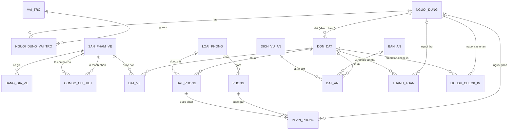
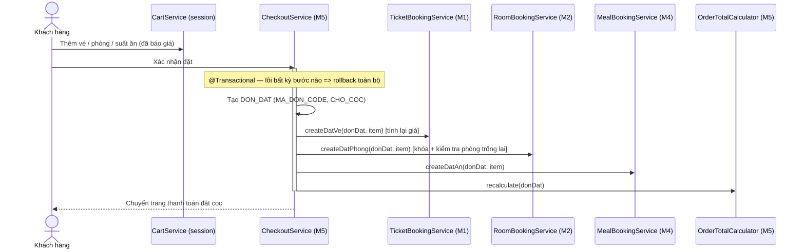
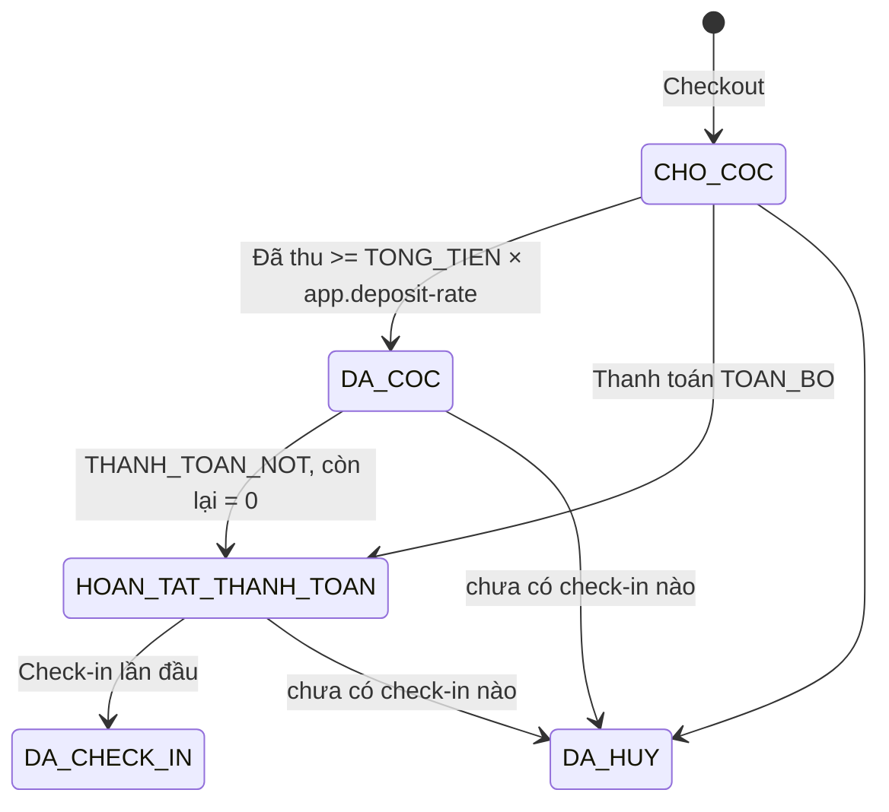
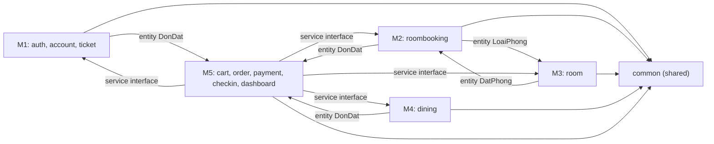

# ARCHITECTURE.md — EcoGate (SkyGateHub)

> Hệ thống Quản lý & Đặt dịch vụ Khu du lịch sinh thái **Cổng Trời Đông Giang**
> Web Monolithic Full-stack · Spring Boot + Thymeleaf (SSR) · MySQL 8.x
> Phiên bản tài liệu: 1.0 — 12/10/2026

---

## 0. Quyết định kiến trúc đã chốt (ADR tóm tắt)

| # | Quyết định | Lý do |
|---|---|---|
| ADR-01 | **Package-by-Feature** dưới root `com.example.skygatehub` (giữ package hiện có của project) | Mỗi thành viên sở hữu trọn 1–5 thư mục riêng → gần như không conflict Git |
| ADR-02 | Mỗi feature có đủ tầng `entity / repository / service (+impl) / controller / dto / enums` | Đúng yêu cầu Layered bên trong từng module |
| ADR-03 | Module khác chỉ được gọi **Service interface** và tham chiếu **Entity** của nhau; **cấm** gọi trực tiếp Repository/Controller của module khác | Giữ ranh giới module, dễ test, dễ thay đổi nội bộ |
| ADR-04 | MySQL 8.x (`QL_CONG_TROI_DONG_GIANG`), file SQL Server chỉ dùng làm **tham chiếu cấu trúc bảng** | Theo chỉ đạo nhóm |
| ADR-05 | `spring.jpa.hibernate.ddl-auto=validate` — **DB là nguồn sự thật**, JPA không tự sinh bảng | Tránh Hibernate tự sửa schema đã chốt |
| ADR-06 | Tên bảng/cột giữ nguyên **IN HOA KHÔNG DẤU**, dùng `PhysicalNamingStrategyStandardImpl` + `@Table/@Column` tường minh | Mặc định Spring đổi `DAT_PHONG` → `dat_phong`, sẽ lỗi khi deploy MySQL trên Linux (phân biệt hoa/thường) |
| ADR-07 | Enum lưu bằng `@Enumerated(EnumType.STRING)`, tên hằng **trùng 100%** giá trị CHECK trong DB | Không cần converter, khớp ràng buộc DB |
| ADR-08 | Giỏ hàng **không có bảng** → lưu trong `HttpSession` (bean `@SessionScope`) | Schema không có bảng giỏ hàng; giỏ chỉ là trạng thái tạm trước khi tạo `DON_DAT` |
| ADR-09 | Chưa bật Spring Security; dùng `AuthInterceptor` + `@RequireRole` + session. URL được quy hoạch sẵn theo role để gắn Spring Security sau mà không đổi controller | Đúng yêu cầu giai đoạn khung sườn |
| ADR-10 | Hash mật khẩu bằng **BCrypt** qua thư viện `spring-security-crypto` (chỉ thư viện mã hóa, không kích hoạt filter Security) | Không lưu mật khẩu thuần ngay từ đầu |
| ADR-11 | Layout Thymeleaf bằng **fragment** (`th:replace`), không thêm Layout Dialect | Bớt dependency |

> [!NOTE]
> `pom.xml` hiện đang dùng **Spring Boot 4.1.1** (prompt ghi 3.x). Kiến trúc này tương thích cả hai (Jakarta EE, Hibernate 6/7). Nhóm cần chốt 1 phiên bản và **không tự ý nâng cấp** trong quá trình làm.

---

## 1. Phân tích Domain Model

### 1.1. Bản đồ bảng → Bounded Context → Thành viên

| Context | Bảng | Chủ sở hữu |
|---|---|---|
| Tài khoản & Phân quyền | `NGUOI_DUNG`, `VAI_TRO`, `NGUOI_DUNG_VAI_TRO` | **M1** |
| Vé tham quan & Combo | `SAN_PHAM_VE`, `COMBO_CHI_TIET`, `BANG_GIA_VE`, `DAT_VE` | **M1** |
| Đặt phòng (phía khách) | `DAT_PHONG` | **M2** |
| Vận hành phòng (phía quản trị) | `LOAI_PHONG`, `PHONG`, `PHAN_PHONG` | **M3** |
| Ẩm thực | `DICH_VU_AN`, `BAN_AN`, `DAT_AN` | **M4** |
| Đơn tổng, Thanh toán, Check-in | `DON_DAT`, `THANH_TOAN`, `LICHSU_CHECK_IN` (+ giỏ hàng session) | **M5** |

> [!IMPORTANT]
> Schema thực tế có **17 bảng** (prompt ghi 16 — thiếu đếm `DAT_VE`).
> Quan hệ đúng là **các bảng dịch vụ (`DAT_VE`, `DAT_PHONG`, `DAT_AN`) có FK trỏ về `DON_DAT`** (1 đơn — N dịch vụ), **không phải** `DON_DAT` chứa FK đến các bảng dịch vụ. Đây là thiết kế đúng (tránh FK đa hình).

### 1.2. Sơ đồ quan hệ



### 1.3. Ánh xạ kiểu dữ liệu & lưu ý JPA

| DB (MySQL) | Java | Ghi chú |
|---|---|---|
| `INT AUTO_INCREMENT` | `Integer` + `@GeneratedValue(strategy = IDENTITY)` | |
| `DECIMAL(18,2)` / `DECIMAL(5,2)` | `BigDecimal` | **Cấm** dùng `double` cho tiền |
| `DATE` | `LocalDate` | `NGAY_NHAN_PHONG`, `NGAY_SU_DUNG`, `NGAY_DUNG_BUA` |
| `DATETIME` | `LocalDateTime` | |
| `BIT/TINYINT(1)` | `Boolean` | `LA_COMBO` |
| `VARCHAR` trạng thái | `enum` + `@Enumerated(STRING)` | |
| `DAT_VE.THANH_TIEN`, `DAT_AN.THANH_TIEN` (cột tính toán, MySQL: `GENERATED ALWAYS AS (...) STORED`) | `@Column(insertable = false, updatable = false)` | DB tự tính; Java chỉ đọc. Nếu cần giá trị ngay sau `save()` → `entityManager.refresh()` |
| `NGUOI_DUNG_VAI_TRO` (bảng nối thuần, không cột phụ) | `@ManyToMany @JoinTable` trong `NguoiDung` | **Không** tạo entity riêng |
| `COMBO_CHI_TIET` (khóa kép + cột `SO_LUONG`) | Entity `ComboChiTiet` + `@EmbeddedId ComboChiTietId` | |

Quy ước chung cho Entity:
- Tất cả quan hệ `@ManyToOne(fetch = LAZY)`; **không** dùng `@OneToMany` hai chiều trừ khi thực sự cần (giảm vòng lặp `toString`/JSON).
- Lombok: dùng `@Getter @Setter @NoArgsConstructor`, **không** dùng `@Data` trên Entity (lỗi `hashCode`/lazy loading).
- `spring.jpa.open-in-view=false` → Controller nhận **DTO**, không nhận Entity.

---

## 2. Business Logic cốt lõi — các "điểm chốt chặn"

Quy ước chung: mọi phương thức ghi dữ liệu nằm ở `ServiceImpl` với `@Transactional`; mọi vi phạm ném `BusinessException(ErrorCode.XXX)` và được `GlobalExceptionHandler` chuyển thành thông báo flash.

### 2.1. Xác định loại ngày (dùng chung Vé + Phòng) — `common/util/DayTypeResolver`

```
LoaiNgay resolve(LocalDate d):
    if d.getDayOfWeek() == SATURDAY  -> THU_BAY_LE
    if MonthDay.from(d) ∈ app.holidays -> THU_BAY_LE
    else                                -> NGAY_THUONG      // gồm cả thứ Sáu và Chủ Nhật
```
- Danh sách ngày lễ đặt trong `application.properties` dạng **`MM-dd` lặp lại hằng năm** (`app.holidays=01-01,04-30,05-01,09-02`) — **không hard-code** (Quyết định D2).
- Đây là component **dùng chung duy nhất** cho cả M1 và M2 → tránh 2 người viết 2 logic khác nhau.

### 2.2. Tính giá vé & combo (M1) — `TicketPricingService`

```
Input : maSanPham, ngaySuDung, soNguoiLon, soTreEm
1. SanPhamVe phải TRANG_THAI = DANG_BAN.
2. loaiNgay = DayTypeResolver.resolve(ngaySuDung).
3. donGiaNL = BANG_GIA_VE[maSanPham, NGUOI_LON, loaiNgay]   (UQ_GIA_VE đảm bảo duy nhất)
   donGiaTE = BANG_GIA_VE[maSanPham, TRE_EM,    loaiNgay]
   -> không tìm thấy = BusinessException(PRICE_NOT_CONFIGURED)
4. soNguoiLon + soTreEm > 0  (khớp CHK_DATVE_SOLUONG)
5. thanhTien = soNL*donGiaNL + soTE*donGiaTE   (chỉ để hiển thị; DB tự tính cột THANH_TIEN)
6. Khi tạo DAT_VE: SNAPSHOT donGiaNL/donGiaTE vào DON_GIA_NGUOI_LON / DON_GIA_TRE_EM.
```
- **Quy tắc trẻ em < 1,4 m miễn phí:** khuyến nghị cấu hình dòng giá `TRE_EM = 0` và giao diện ghi rõ "Trẻ em dưới 1,4 m"; khách **từ 1,4 m trở lên tính là `NGUOI_LON`**.
- **Combo** = 1 `SAN_PHAM_VE` có `LA_COMBO = 1` với **giá riêng** trong `BANG_GIA_VE` (không cộng dồn giá thành phần). `COMBO_CHI_TIET` dùng để hiển thị "combo gồm gì" và để **check-in từng thành phần** (`VE_CONG`, `CAP_TREO`, `AN_UONG`).
- Validate khi tạo combo: thành phần phải tồn tại, `LA_COMBO = 0` (không lồng combo), `SO_LUONG > 0`, không được chứa chính nó.

### 2.3. Kiểm tra phòng trống theo khoảng ngày (M2) — `RoomAvailabilityService`

Hai khoảng ngày `[in1, out1)` và `[in2, out2)` **chồng lấn** khi: `in1 < out2 AND out1 > in2` (ngày trả phòng không tính là đêm ở → khách A trả 15/10, khách B nhận 15/10 là hợp lệ).

```
soPhongCon(maLoaiPhong, in, out) =
      COUNT(PHONG  WHERE MA_LOAI_PHONG = ? AND TRANG_THAI <> 'BAO_TRI')
    - SUM(DP.SO_LUONG_PHONG)
        FROM DAT_PHONG DP JOIN DON_DAT DD
        WHERE DP.MA_LOAI_PHONG = ?
          AND DP.TRANG_THAI <> 'DA_TRA_PHONG'
          AND DD.TRANG_THAI_DON <> 'DA_HUY'
          AND DP.NGAY_NHAN_PHONG < :out AND DP.NGAY_TRA_PHONG > :in
```
Validate bổ sung: `out > in` (khớp `CHK_DATPHONG_NGAY`), `in >= hôm nay`, `SO_NGUOI_LON <= SUC_CHUA_NGUOI_LON × SO_LUONG_PHONG`.

> [!WARNING]
> **Race condition**: 2 khách cùng đặt phòng cuối cùng. Khi tạo `DAT_PHONG` trong transaction, phải **khóa dòng `LOAI_PHONG`** (`@Lock(PESSIMISTIC_WRITE)` → `SELECT ... FOR UPDATE`) rồi **kiểm tra lại** số phòng trống trước khi insert.

### 2.4. Tính tiền phòng + phụ thu (M2) — `RoomPricingService`

```
for each đêm d in [in, out):            // số đêm = out - in
    giaDem   = GIA_CO_BAN
    phuThu_d = isPeak(d) ? GIA_CO_BAN × TY_LE_PHU_THU_CUOI_TUAN : 0     // mặc định 0.20
GIA_AP_DUNG_MOI_DEM = GIA_CO_BAN                     (snapshot giá cơ bản)
TIEN_PHU_THU        = SO_LUONG_PHONG × Σ phuThu_d
THANH_TIEN          = SO_LUONG_PHONG × GIA_CO_BAN × soDem + TIEN_PHU_THU
isPeak(d)           = DayTypeResolver.resolve(d) == THU_BAY_LE
```
- Trẻ em < 1,4 m miễn phí → `SO_TRE_EM` chỉ để thống kê, không cộng tiền.
- Trả về `RoomQuoteResponse` có **bảng chi tiết từng đêm** (`NightPriceLine`) để hiển thị minh bạch cho khách và dễ kiểm thử.

### 2.5. Phân phòng vật lý (M3) — `RoomAssignmentService`

```
assign(maDatPhong, maPhong, nguoiPhan):
1. DAT_PHONG.TRANG_THAI ∈ {CHO_PHAN_PHONG} và đơn không DA_HUY.
2. PHONG.MA_LOAI_PHONG == DAT_PHONG.MA_LOAI_PHONG, PHONG.TRANG_THAI <> BAO_TRI.
3. Phòng KHÔNG được gán cho DAT_PHONG khác có khoảng ngày chồng lấn:
     NOT EXISTS (PHAN_PHONG PP JOIN DAT_PHONG DP2
                 WHERE PP.MA_PHONG = ? AND DP2.TRANG_THAI <> 'DA_TRA_PHONG'
                   AND DP2.NGAY_NHAN_PHONG < :out AND DP2.NGAY_TRA_PHONG > :in)
4. COUNT(PHAN_PHONG của maDatPhong) < SO_LUONG_PHONG.
5. Insert PHAN_PHONG (NGUOI_PHAN = nhân viên hiện tại).
6. Nếu đủ SO_LUONG_PHONG -> DAT_PHONG.TRANG_THAI = DA_PHAN_PHONG.
```
> [!IMPORTANT]
> `UQ_PHANPHONG (MA_DAT_PHONG, MA_PHONG)` chỉ chặn gán trùng **trong cùng 1 đặt phòng**, **không** chặn trùng thời gian giữa 2 đặt phòng → bước 3 là bắt buộc ở tầng Service.

Sơ đồ phòng (`RoomMapService`): lưới theo `TANG`, mỗi ô = 1 `PHONG` với trạng thái hiển thị tại ngày được chọn (Trống / Đã phân / Đang ở / Bảo trì / Đang dọn).

### 2.6. Ẩm thực & xếp bàn (M4) — `MealBookingService`, `TableAssignmentService`

- Đặt ăn **không bắt buộc**; đơn có thể không có `DAT_AN`.
- Ràng buộc ca ↔ loại dịch vụ: `BUFFET_SANG → SANG`, `SET_TRUA → TRUA`, `SET_TOI_THUONG / SET_TOI_DAC_SAN → TOI`.
- `DON_GIA` = snapshot `DICH_VU_AN.GIA_TIEN` tại thời điểm đặt; `THANH_TIEN` do DB tính.
- `NGAY_DUNG_BUA` nên nằm trong khoảng lưu trú/ngày tham quan của cùng đơn (cảnh báo, không chặn cứng).
- Xếp bàn: 1 `BAN_AN` không được gán cho 2 `DAT_AN` cùng `(NGAY_DUNG_BUA, CA_AN)`; `SO_SUAT <= SUC_CHUA`; bàn `BAO_TRI` không được xếp.
- `BAN_AN.TRANG_THAI` là trạng thái **thời gian thực** (đang dùng/sẵn sàng), **không** dùng để suy ra lịch đặt theo ngày.

### 2.7. Giỏ hàng → Checkout → Đơn tổng (M5)


- **Luôn tính lại giá ở server** khi checkout; giá trong session chỉ để hiển thị.
- `MA_DON_CODE` sinh bởi `OrderCodeGenerator`, định dạng gợi ý: `CTDG-yyMMdd-XXXX`.
- `OrderTotalCalculator.recalculate(donDat)`:
  `TONG_TIEN = Σ DAT_VE.THANH_TIEN + Σ DAT_PHONG.THANH_TIEN + Σ DAT_AN.THANH_TIEN`

### 2.8. Nhiều đợt thanh toán (M5) — `PaymentService`

```
TIEN_DA_THU   = Σ SO_TIEN (TRANG_THAI = THANH_CONG, LOAI ∈ {DAT_COC, THANH_TOAN_NOT, TOAN_BO})
              − Σ SO_TIEN (TRANG_THAI = THANH_CONG, LOAI = HOAN_TIEN)
DON_DAT.TIEN_DA_COC  := TIEN_DA_THU          // cột này mang nghĩa "tổng đã thu"
DON_DAT.TIEN_CON_LAI := TONG_TIEN − TIEN_DA_THU
```
Máy trạng thái `DON_DAT.TRANG_THAI_DON`:


Quy tắc:
- `SO_TIEN > 0` và `SO_TIEN <= TIEN_CON_LAI` (trừ `HOAN_TIEN`).
- Giao dịch `THAT_BAI` / `DANG_XU_LY` **không** được cộng vào tiền đã thu.
- Bản ghi `THANH_TOAN` là **bất biến** (không sửa/xóa) — muốn điều chỉnh thì tạo giao dịch `HOAN_TIEN`.
- Thanh toán tại quầy: `NGUOI_THU` = nhân viên hiện tại; khách tự thanh toán online (`VNPAY_MO_PHONG`): `NGUOI_THU = NULL`.
- Khóa dòng `DON_DAT` (`PESSIMISTIC_WRITE`) khi ghi thanh toán để tránh 2 giao dịch đồng thời làm sai số dư (schema không có cột `version`).
- Tỷ lệ cọc cấu hình `app.deposit-rate=0.30` (Quyết định D3).
- Hủy đơn: chỉ khi **chưa có bản ghi `LICHSU_CHECK_IN`** nào; **không** tự động sinh giao dịch `HOAN_TIEN` (Quyết định D3).

### 2.9. Quy trình Check-in (M5) — `CheckInService`

```
1. Tra cứu đơn theo MA_DON_CODE (hoặc SĐT khách).
2. Hiển thị: thông tin khách, dịch vụ đã đặt, TONG_TIEN / đã thu / còn lại, phòng đã phân.
3. Nếu TIEN_CON_LAI > 0 -> bắt buộc thu nốt (tạo THANH_TOAN THANH_TOAN_NOT) trước khi check-in.
4. Ghi LICHSU_CHECK_IN(LOAI_DICH_VU_CHECK_IN, NGUOI_XAC_NHAN = nhân viên hiện tại).
   - VE_CONG / CAP_TREO : đơn có DAT_VE (hoặc combo có thành phần tương ứng) với NGAY_SU_DUNG = hôm nay.
   - NHAN_PHONG         : mọi DAT_PHONG phải DA_PHAN_PHONG -> chuyển DA_NHAN_PHONG, PHONG -> DANG_O.
   - AN_UONG            : có DAT_AN ngày hôm nay, đúng ca.
   - Chặn check-in trùng: cùng đơn + cùng loại + cùng ngày.
5. Lần check-in đầu tiên -> DON_DAT.TRANG_THAI_DON = DA_CHECK_IN.
```
> [!NOTE]
> `LICHSU_CHECK_IN` chỉ FK đến `DON_DAT`, không FK đến từng `DAT_VE`/`DAT_AN` → check-in ở mức "đơn + loại dịch vụ". Chấp nhận được trong phạm vi đồ án.

### 2.10. Dashboard (M5)
Doanh thu theo ngày/tháng (từ `THANH_TOAN` thành công), số đơn theo trạng thái, công suất phòng theo ngày, số suất ăn theo ca, top sản phẩm vé. Truy vấn tổng hợp đặt trong `DashboardQueryRepository` (JPQL/native, **read-only**).

---

## 3. Phân quyền (sẵn sàng gắn Spring Security)

### 3.1. Vai trò (`common/enums/RoleName`)
`QUAN_LY`, `NHAN_VIEN_CHECK_IN`, `NHAN_VIEN_PHAN_PHONG`, `NHAN_VIEN_PHAN_BAN`, `KHACH_HANG`

### 3.2. Ma trận URL ↔ Role

| URL prefix | Vai trò được phép | Module |
|---|---|---|
| `/`, `/tickets/**`, `/rooms/**`, `/dining/**`, `/auth/**`, `/css/**`, `/js/**`, `/images/**` | Public | — |
| `/cart/**`, `/checkout/**`, `/orders/**`, `/payments/**`, `/account/**` | `KHACH_HANG` | M1, M5 |
| `/admin/dashboard/**`, `/admin/accounts/**`, `/admin/tickets/**`, `/admin/ticket-prices/**`, `/admin/room-types/**`, `/admin/dining-services/**`, `/admin/orders/**` | `QUAN_LY` | M1, M3, M4, M5 |
| `/admin/rooms/**`, `/admin/room-map/**`, `/admin/room-assignments/**` | `NHAN_VIEN_PHAN_PHONG`, `QUAN_LY` | M3 |
| `/admin/tables/**`, `/admin/table-assignments/**`, `/admin/meal-schedule/**` | `NHAN_VIEN_PHAN_BAN`, `QUAN_LY` | M4 |
| `/admin/checkin/**`, `/admin/payments/**` | `NHAN_VIEN_CHECK_IN`, `QUAN_LY` | M5 |

Giai đoạn hiện tại: `AuthInterceptor` đọc `CurrentUser` trong session và đối chiếu `@RequireRole` trên controller/method. Khi bật Spring Security: thay interceptor bằng `SecurityFilterChain` với đúng ma trận trên, `@RequireRole` → `@PreAuthorize` — **controller và URL giữ nguyên**.

---

## 4. Cấu trúc Package & Tài nguyên

### 4.1. Java — `src/main/java/com/example/skygatehub/`

```
com.example.skygatehub
├── SkyGateHubApplication.java
├── common/                 ← CHUNG (thay đổi phải qua Pull Request được cả nhóm duyệt)
│   ├── config/   constant/   enums/   exception/   security/   util/   web/
├── auth/                   ← M1
├── account/                ← M1
├── ticket/                 ← M1
├── roombooking/            ← M2
├── room/                   ← M3
├── dining/                 ← M4
├── cart/                   ← M5
├── order/                  ← M5
├── payment/                ← M5
├── checkin/                ← M5
└── dashboard/              ← M5
```
Cấu trúc chuẩn **bên trong mỗi feature**:
```
<feature>/
├── entity/            JPA Entity ánh xạ bảng
├── enums/             Enum trạng thái của feature
├── repository/        Spring Data JPA
├── dto/               Request (có Bean Validation) / Response
├── service/           Interface (hợp đồng public cho module khác)
│   └── impl/          ServiceImpl (@Service, @Transactional)
└── controller/        @Controller (SSR) — tách Customer / Admin
```

### 4.2. Quy tắc phụ thuộc giữa module


- Được phép: import `entity` (để khai báo `@ManyToOne`) và `service` interface của module khác.
- **Không** được phép: import `repository`, `service.impl`, `controller` của module khác.
- **Sprint 0 (bắt buộc làm trước):** mỗi người commit **Entity + Enum + Repository** của mình trong 1–2 ngày đầu, vì các module tham chiếu chéo Entity (`DonDat`, `LoaiPhong`, `DatPhong`, `NguoiDung`).

### 4.3. Templates — `src/main/resources/templates/`
Tổ chức **theo module trước, vai trò sau** (`<module>/<customer|admin>/...`) để mỗi thành viên sở hữu trọn thư mục của mình:
```
templates/
├── layout/  fragments/  error/  index.html     ← CHUNG
├── auth/                                        ← M1
├── account/{customer,admin}/                    ← M1
├── ticket/{customer,admin}/                     ← M1
├── roombooking/customer/                        ← M2
├── room/admin/                                  ← M3
├── dining/{customer,admin}/                     ← M4
├── cart/customer/   order/{customer,admin}/     ← M5
├── payment/{customer,admin}/   checkin/admin/   ← M5
└── dashboard/admin/                             ← M5
```

### 4.4. Static — `src/main/resources/static/`
```
static/
├── css/  base.css, customer.css, admin.css     ← CHUNG (design tokens, layout)
│   └── modules/  <module>.css                   ← từng thành viên
├── js/   common.js                              ← CHUNG
│   └── modules/  <module>.js                    ← từng thành viên
└── images/  tickets/  rooms/  dining/           ← ảnh theo module
```

---

## 5. FILE INVENTORY CHI TIẾT

Ký hiệu: **[C]** = Chung · **[M1]…[M5]** = Thành viên chịu trách nhiệm.
Đường dẫn Java tính từ `src/main/java/com/example/skygatehub/`.

### 5.0. [C] Chung — `common/` và cấu hình

| File | Nhiệm vụ |
|---|---|
| `SkyGateHubApplication.java` | *(đã có)* Class khởi động Spring Boot |
| `common/config/WebMvcConfig.java` | Đăng ký `AuthInterceptor`, resource handler, view controller |
| `common/config/AppProperties.java` | `@ConfigurationProperties("app")`: tỷ lệ cọc, danh sách ngày lễ, prefix mã đơn |
| `common/constant/AppConstants.java` | Hằng số chung: định dạng ngày, page size mặc định |
| `common/constant/SessionKeys.java` | Tên key session: `CURRENT_USER`, `CART` |
| `common/enums/RoleName.java` | Enum 5 vai trò |
| `common/enums/LoaiKhach.java` | `NGUOI_LON`, `TRE_EM` (dùng cho bảng giá vé) |
| `common/enums/LoaiNgay.java` | `NGAY_THUONG`, `THU_BAY_LE` (dùng chung vé + phòng) |
| `common/exception/ErrorCode.java` | Danh mục mã lỗi nghiệp vụ + thông điệp tiếng Việt |
| `common/exception/BusinessException.java` | Exception nghiệp vụ mang `ErrorCode` |
| `common/exception/ResourceNotFoundException.java` | Không tìm thấy bản ghi |
| `common/exception/GlobalExceptionHandler.java` | `@ControllerAdvice`: lỗi → flash message / trang lỗi |
| `common/security/CurrentUser.java` | DTO người dùng đăng nhập lưu trong session (id, họ tên, roles) |
| `common/security/RequireRole.java` | Annotation khai báo role yêu cầu cho controller/method |
| `common/security/AuthInterceptor.java` | Kiểm tra đăng nhập + role theo `@RequireRole` (tạm thay Spring Security) |
| `common/security/PasswordHasher.java` | Wrapper BCrypt (hash / matches) |
| `common/util/DayTypeResolver.java` | Xác định `LoaiNgay` của 1 ngày (thứ Bảy / ngày lễ) |
| `common/util/DateRangeUtils.java` | Tính số đêm, kiểm tra 2 khoảng ngày chồng lấn |
| `common/util/MoneyUtils.java` | Làm tròn, định dạng `BigDecimal` VNĐ |
| `common/util/OrderCodeGenerator.java` | Sinh `MA_DON_CODE` duy nhất |
| `common/web/HomeController.java` | Trang chủ `/` |
| `common/web/GlobalModelAdvice.java` | Đưa `currentUser`, `cartCount` vào mọi view |
| `resources/application.properties` | *(đã có)* Datasource MySQL — bổ sung cấu hình JPA, `app.*` |
| `resources/application-dev.properties` | Cấu hình môi trường dev (show-sql, cache Thymeleaf off) |
| `resources/messages.properties` | Thông điệp validation tiếng Việt |
| `resources/db/mysql/01_schema.sql` | Script MySQL tạo 17 bảng (chuyển từ bản SQL Server) |
| `resources/db/mysql/02_seed_data.sql` | Dữ liệu mẫu *(mô phỏng phục vụ kiểm thử đồ án)* |
| `templates/layout/customer.html` | Layout fragment trang khách |
| `templates/layout/admin.html` | Layout fragment trang quản trị |
| `templates/fragments/header.html` | Thanh điều hướng khách |
| `templates/fragments/footer.html` | Chân trang |
| `templates/fragments/admin-sidebar.html` | Menu quản trị (hiển thị theo role) |
| `templates/fragments/flash-messages.html` | Hiển thị thông báo thành công/lỗi |
| `templates/fragments/pagination.html` | Phân trang dùng chung |
| `templates/index.html` | Trang chủ giới thiệu khu du lịch |
| `templates/error/403.html`, `404.html`, `500.html` | Trang lỗi |
| `static/css/base.css` | Design tokens (màu, font, spacing), reset |
| `static/css/customer.css` | Layout giao diện khách |
| `static/css/admin.css` | Layout giao diện quản trị |
| `static/js/common.js` | Tiện ích JS: format tiền, confirm, toast |
| `static/images/{tickets,rooms,dining}/.gitkeep` | Giữ thư mục ảnh trong Git |

### 5.1. [M1] Auth, Tài khoản & Vé tham quan / Combo

**`auth/`**

| File | Nhiệm vụ |
|---|---|
| `auth/dto/LoginRequest.java` | Form đăng nhập (tên đăng nhập, mật khẩu) |
| `auth/dto/RegisterRequest.java` | Form đăng ký khách hàng (validate SĐT, email, mật khẩu) |
| `auth/service/AuthService.java` | Hợp đồng: đăng nhập, đăng ký, đăng xuất |
| `auth/service/impl/AuthServiceImpl.java` | Xác thực BCrypt, chặn tài khoản `KHOA`, gán role `KHACH_HANG` khi đăng ký |
| `auth/controller/AuthController.java` | `/auth/login`, `/auth/register`, `/auth/logout` |

**`account/`**

| File | Nhiệm vụ |
|---|---|
| `account/entity/NguoiDung.java` | Entity `NGUOI_DUNG` + `@ManyToMany` vai trò qua `NGUOI_DUNG_VAI_TRO` |
| `account/entity/VaiTro.java` | Entity `VAI_TRO` |
| `account/enums/TrangThaiNguoiDung.java` | `HOAT_DONG`, `KHOA` |
| `account/repository/NguoiDungRepository.java` | Tìm theo tên đăng nhập / SĐT, lọc theo role |
| `account/repository/VaiTroRepository.java` | Tìm vai trò theo tên |
| `account/dto/UserCreateRequest.java` | Quản lý tạo tài khoản nhân viên + chọn role |
| `account/dto/ProfileUpdateRequest.java` | Khách cập nhật hồ sơ / đổi mật khẩu |
| `account/dto/UserResponse.java` | Dữ liệu hiển thị tài khoản |
| `account/service/AccountService.java` | Hợp đồng quản lý tài khoản (dùng bởi module khác để lấy `NguoiDung`) |
| `account/service/impl/AccountServiceImpl.java` | CRUD tài khoản, gán/thu hồi role, khóa/mở khóa |
| `account/controller/ProfileController.java` | `/account/profile` (khách) |
| `account/controller/AdminAccountController.java` | `/admin/accounts` (quản lý) |
| `account/config/AccountDataSeeder.java` | Seed 5 vai trò + tài khoản quản lý mặc định nếu DB trống |

**`ticket/`**

| File | Nhiệm vụ |
|---|---|
| `ticket/entity/SanPhamVe.java` | Entity `SAN_PHAM_VE` (vé lẻ / combo) |
| `ticket/entity/ComboChiTiet.java` | Entity `COMBO_CHI_TIET` (thành phần combo + số lượng) |
| `ticket/entity/ComboChiTietId.java` | `@Embeddable` khóa kép (MA_COMBO, MA_SAN_PHAM_CON) |
| `ticket/entity/BangGiaVe.java` | Entity `BANG_GIA_VE` (giá theo loại khách × loại ngày) |
| `ticket/entity/DatVe.java` | Entity `DAT_VE` (FK `DonDat`; `THANH_TIEN` read-only) |
| `ticket/enums/TrangThaiSanPham.java` | `DANG_BAN`, `NGUNG_BAN` |
| `ticket/repository/SanPhamVeRepository.java` | Truy vấn sản phẩm đang bán, lọc combo |
| `ticket/repository/ComboChiTietRepository.java` | Lấy thành phần của combo |
| `ticket/repository/BangGiaVeRepository.java` | Tìm giá theo (sản phẩm, loại khách, loại ngày) |
| `ticket/repository/DatVeRepository.java` | Lấy vé theo đơn / theo ngày sử dụng |
| `ticket/dto/SanPhamVeRequest.java` | Form tạo/sửa sản phẩm vé |
| `ticket/dto/ComboItemRequest.java` | Dòng thành phần combo trong form |
| `ticket/dto/BangGiaVeRequest.java` | Form cấu hình giá |
| `ticket/dto/SanPhamVeResponse.java` | Hiển thị sản phẩm + bảng giá + thành phần combo |
| `ticket/dto/TicketQuoteRequest.java` | Yêu cầu báo giá (sản phẩm, ngày, số NL/TE) |
| `ticket/dto/TicketQuoteResponse.java` | Kết quả báo giá (loại ngày, đơn giá, thành tiền) |
| `ticket/service/SanPhamVeService.java` | Hợp đồng quản lý sản phẩm vé/combo |
| `ticket/service/impl/SanPhamVeServiceImpl.java` | CRUD, validate combo (không lồng, không tự chứa) |
| `ticket/service/BangGiaVeService.java` | Hợp đồng quản lý bảng giá |
| `ticket/service/impl/BangGiaVeServiceImpl.java` | CRUD giá, đảm bảo duy nhất `UQ_GIA_VE` |
| `ticket/service/TicketPricingService.java` | Hợp đồng tính giá vé |
| `ticket/service/impl/TicketPricingServiceImpl.java` | Áp dụng `DayTypeResolver` + bảng giá (mục 2.2) |
| `ticket/service/TicketBookingService.java` | **Hợp đồng public cho M5**: `createDatVe(DonDat, ...)` |
| `ticket/service/impl/TicketBookingServiceImpl.java` | Tạo `DAT_VE`, snapshot đơn giá |
| `ticket/controller/TicketController.java` | `/tickets` danh sách, chi tiết, báo giá, thêm vào giỏ |
| `ticket/controller/AdminTicketController.java` | `/admin/tickets` quản lý sản phẩm + combo |
| `ticket/controller/AdminTicketPriceController.java` | `/admin/ticket-prices` quản lý bảng giá |

**Templates & Static [M1]**

| File | Nhiệm vụ |
|---|---|
| `templates/auth/login.html` | Trang đăng nhập |
| `templates/auth/register.html` | Trang đăng ký |
| `templates/account/customer/profile.html` | Hồ sơ khách hàng |
| `templates/account/admin/list.html` | Danh sách tài khoản + lọc role |
| `templates/account/admin/form.html` | Tạo/sửa tài khoản nhân viên |
| `templates/ticket/customer/list.html` | Danh sách vé & combo |
| `templates/ticket/customer/detail.html` | Chi tiết vé, chọn ngày + số người, báo giá |
| `templates/ticket/admin/list.html` | Quản lý sản phẩm vé |
| `templates/ticket/admin/form.html` | Form vé lẻ |
| `templates/ticket/admin/combo-form.html` | Form combo + thành phần |
| `templates/ticket/admin/price-list.html` | Ma trận giá (sản phẩm × loại khách × loại ngày) |
| `static/css/modules/ticket.css` | Style module vé |
| `static/js/modules/ticket-quote.js` | Gọi báo giá khi đổi ngày/số lượng |
| `static/js/modules/auth.js` | Validate form đăng nhập/đăng ký phía client |

### 5.2. [M2] Đặt phòng lưu trú — phía Khách hàng (`roombooking/`)

| File | Nhiệm vụ |
|---|---|
| `roombooking/entity/DatPhong.java` | Entity `DAT_PHONG` (FK `DonDat`, `LoaiPhong`) |
| `roombooking/enums/TrangThaiDatPhong.java` | `CHO_PHAN_PHONG`, `DA_PHAN_PHONG`, `DA_NHAN_PHONG`, `DA_TRA_PHONG` |
| `roombooking/repository/DatPhongRepository.java` | Query tổng số phòng đã đặt chồng lấn khoảng ngày (mục 2.3) |
| `roombooking/dto/RoomSearchRequest.java` | Ngày nhận/trả, số người lớn/trẻ em, số phòng |
| `roombooking/dto/RoomAvailabilityResponse.java` | Loại phòng + số phòng còn trống + giá tham khảo |
| `roombooking/dto/RoomQuoteRequest.java` | Yêu cầu báo giá 1 loại phòng |
| `roombooking/dto/RoomQuoteResponse.java` | Tổng tiền, phụ thu, chi tiết từng đêm |
| `roombooking/dto/NightPriceLine.java` | 1 dòng giá theo đêm (ngày, loại ngày, giá, phụ thu) |
| `roombooking/service/RoomAvailabilityService.java` | Hợp đồng kiểm tra phòng trống (M3 cũng dùng) |
| `roombooking/service/impl/RoomAvailabilityServiceImpl.java` | Công thức mục 2.3 |
| `roombooking/service/RoomPricingService.java` | Hợp đồng tính tiền phòng |
| `roombooking/service/impl/RoomPricingServiceImpl.java` | Công thức mục 2.4 |
| `roombooking/service/RoomBookingService.java` | **Hợp đồng public cho M5**: `createDatPhong(DonDat, ...)` |
| `roombooking/service/impl/RoomBookingServiceImpl.java` | Khóa `LOAI_PHONG`, kiểm tra lại, tạo `DAT_PHONG` |
| `roombooking/controller/RoomBookingController.java` | `/rooms`, `/rooms/search`, `/rooms/book` (thêm vào giỏ) |
| `roombooking/controller/RoomQuoteApiController.java` | `GET /api/rooms/quote` trả JSON báo giá động |
| `templates/roombooking/customer/search.html` | Form tìm phòng theo ngày |
| `templates/roombooking/customer/results.html` | Kết quả loại phòng còn trống |
| `templates/roombooking/customer/booking-form.html` | Chọn số phòng, số khách, xem chi tiết giá từng đêm |
| `static/css/modules/room-booking.css` | Style module đặt phòng |
| `static/js/modules/room-search.js` | Date range picker, gọi API báo giá |

### 5.3. [M3] Vận hành phòng lưu trú — phía Quản trị (`room/`)

| File | Nhiệm vụ |
|---|---|
| `room/entity/LoaiPhong.java` | Entity `LOAI_PHONG` (giá cơ bản, tỷ lệ phụ thu) |
| `room/entity/Phong.java` | Entity `PHONG` (phòng vật lý) |
| `room/entity/PhanPhong.java` | Entity `PHAN_PHONG` (gán phòng ↔ đặt phòng) |
| `room/enums/TrangThaiPhong.java` | `SAN_SANG`, `DANG_O`, `BAO_TRI`, `DANG_DON` |
| `room/repository/LoaiPhongRepository.java` | CRUD + `findByIdForUpdate` (khóa bi quan cho M2) |
| `room/repository/PhongRepository.java` | Đếm phòng khả dụng theo loại, tìm phòng trống theo khoảng ngày |
| `room/repository/PhanPhongRepository.java` | Kiểm tra trùng lịch phòng, đếm số phòng đã phân |
| `room/dto/LoaiPhongRequest.java` | Form loại phòng |
| `room/dto/PhongRequest.java` | Form phòng vật lý |
| `room/dto/RoomAssignRequest.java` | Yêu cầu phân phòng (mã đặt phòng, mã phòng) |
| `room/dto/PendingAssignmentResponse.java` | Đặt phòng chờ phân + danh sách phòng gợi ý |
| `room/dto/RoomMapCell.java` | 1 ô trên sơ đồ phòng (số phòng, tầng, trạng thái theo ngày) |
| `room/service/LoaiPhongService.java` | Hợp đồng quản lý loại phòng (M2 dùng để đọc) |
| `room/service/impl/LoaiPhongServiceImpl.java` | CRUD loại phòng |
| `room/service/PhongService.java` | Hợp đồng quản lý phòng vật lý |
| `room/service/impl/PhongServiceImpl.java` | CRUD phòng, đổi trạng thái (M5 gọi khi nhận phòng) |
| `room/service/RoomAssignmentService.java` | Hợp đồng phân phòng |
| `room/service/impl/RoomAssignmentServiceImpl.java` | Quy trình mục 2.5 |
| `room/service/RoomMapService.java` | Hợp đồng dựng sơ đồ phòng |
| `room/service/impl/RoomMapServiceImpl.java` | Tổng hợp trạng thái phòng theo ngày |
| `room/controller/AdminRoomTypeController.java` | `/admin/room-types` |
| `room/controller/AdminRoomController.java` | `/admin/rooms` |
| `room/controller/AdminRoomMapController.java` | `/admin/room-map` |
| `room/controller/AdminRoomAssignmentController.java` | `/admin/room-assignments` |
| `templates/room/admin/type-list.html` | Danh sách loại phòng |
| `templates/room/admin/type-form.html` | Form loại phòng |
| `templates/room/admin/room-list.html` | Danh sách phòng vật lý |
| `templates/room/admin/room-form.html` | Form phòng vật lý |
| `templates/room/admin/room-map.html` | Sơ đồ phòng theo tầng/ngày |
| `templates/room/admin/assignment-list.html` | Danh sách đặt phòng chờ phân |
| `templates/room/admin/assignment-form.html` | Chọn phòng vật lý để phân |
| `static/css/modules/room-admin.css` | Style sơ đồ phòng |
| `static/js/modules/room-map.js` | Tương tác sơ đồ (chọn ngày, click ô phòng) |

### 5.4. [M4] Ẩm thực & Nhà hàng (`dining/`)

| File | Nhiệm vụ |
|---|---|
| `dining/entity/DichVuAn.java` | Entity `DICH_VU_AN` |
| `dining/entity/BanAn.java` | Entity `BAN_AN` |
| `dining/entity/DatAn.java` | Entity `DAT_AN` (FK `DonDat`, `DichVuAn`, `BanAn` nullable; `THANH_TIEN` read-only) |
| `dining/enums/LoaiDichVuAn.java` | `BUFFET_SANG`, `SET_TRUA`, `SET_TOI_THUONG`, `SET_TOI_DAC_SAN` |
| `dining/enums/CaAn.java` | `SANG`, `TRUA`, `TOI` |
| `dining/enums/TrangThaiBan.java` | `SAN_SANG`, `DANG_DUNG`, `BAO_TRI` |
| `dining/repository/DichVuAnRepository.java` | CRUD dịch vụ ăn |
| `dining/repository/BanAnRepository.java` | Tìm bàn trống theo ngày + ca + sức chứa |
| `dining/repository/DatAnRepository.java` | Lấy suất ăn theo đơn / theo ngày + ca |
| `dining/dto/DichVuAnRequest.java` | Form dịch vụ ăn |
| `dining/dto/BanAnRequest.java` | Form bàn ăn |
| `dining/dto/MealBookingRequest.java` | Khách chọn suất (dịch vụ, ngày, ca, số suất) |
| `dining/dto/TableAssignRequest.java` | Yêu cầu xếp bàn |
| `dining/dto/MealScheduleRow.java` | 1 dòng lịch phục vụ theo ngày/ca |
| `dining/service/DichVuAnService.java` | Hợp đồng quản lý dịch vụ ăn |
| `dining/service/impl/DichVuAnServiceImpl.java` | CRUD dịch vụ ăn |
| `dining/service/BanAnService.java` | Hợp đồng quản lý bàn |
| `dining/service/impl/BanAnServiceImpl.java` | CRUD bàn |
| `dining/service/MealBookingService.java` | **Hợp đồng public cho M5**: `createDatAn(DonDat, ...)` |
| `dining/service/impl/MealBookingServiceImpl.java` | Validate ca ↔ loại dịch vụ, snapshot đơn giá |
| `dining/service/TableAssignmentService.java` | Hợp đồng xếp bàn |
| `dining/service/impl/TableAssignmentServiceImpl.java` | Chặn trùng bàn cùng ngày + ca, kiểm tra sức chứa |
| `dining/controller/DiningController.java` | `/dining` thực đơn + đặt suất ăn (thêm vào giỏ) |
| `dining/controller/AdminDiningServiceController.java` | `/admin/dining-services` |
| `dining/controller/AdminTableController.java` | `/admin/tables` |
| `dining/controller/AdminTableAssignmentController.java` | `/admin/table-assignments`, `/admin/meal-schedule` |
| `templates/dining/customer/menu.html` | Thực đơn buffet / set menu |
| `templates/dining/customer/booking-form.html` | Chọn ngày, ca, số suất |
| `templates/dining/admin/service-list.html` | Danh sách dịch vụ ăn |
| `templates/dining/admin/service-form.html` | Form dịch vụ ăn |
| `templates/dining/admin/table-list.html` | Danh sách bàn |
| `templates/dining/admin/table-form.html` | Form bàn |
| `templates/dining/admin/meal-schedule.html` | Lịch phục vụ theo ngày/ca |
| `templates/dining/admin/table-assignment.html` | Xếp bàn cho suất ăn |
| `static/css/modules/dining.css` | Style module ẩm thực |
| `static/js/modules/dining.js` | Lọc ca theo loại dịch vụ, tính tiền tạm |

### 5.5. [M5] Giỏ hàng, Đơn tổng, Thanh toán, Check-in & Dashboard

**`cart/`**

| File | Nhiệm vụ |
|---|---|
| `cart/model/Cart.java` | Giỏ hàng `@SessionScope` (danh sách item, tổng tạm) |
| `cart/model/CartItem.java` | 1 item: loại + payload (vé / phòng / suất ăn) + giá tạm |
| `cart/enums/CartItemType.java` | `VE`, `PHONG`, `AN` |
| `cart/service/CartService.java` | Hợp đồng thêm/xóa/sửa item (M1, M2, M4 gọi để thêm vào giỏ) |
| `cart/service/impl/CartServiceImpl.java` | Thao tác giỏ, gọi báo giá các module để hiển thị |
| `cart/controller/CartController.java` | `/cart` xem, xóa, cập nhật |

**`order/`**

| File | Nhiệm vụ |
|---|---|
| `order/entity/DonDat.java` | Entity `DON_DAT` (đơn tổng) |
| `order/enums/TrangThaiDon.java` | `CHO_COC`, `DA_COC`, `HOAN_TAT_THANH_TOAN`, `DA_CHECK_IN`, `DA_HUY` |
| `order/repository/DonDatRepository.java` | Tìm theo mã đơn, khách hàng, trạng thái; `findByIdForUpdate` |
| `order/dto/CheckoutRequest.java` | Ghi chú, xác nhận điều khoản |
| `order/dto/OrderSummaryResponse.java` | Dòng tóm tắt đơn (danh sách) |
| `order/dto/OrderDetailResponse.java` | Chi tiết đơn: vé, phòng, suất ăn, thanh toán, check-in |
| `order/service/CheckoutService.java` | Hợp đồng chuyển giỏ → đơn |
| `order/service/impl/CheckoutServiceImpl.java` | Transaction mục 2.7 |
| `order/service/OrderService.java` | Hợp đồng tra cứu/hủy đơn, cập nhật trạng thái |
| `order/service/impl/OrderServiceImpl.java` | Tra cứu, hủy đơn, áp máy trạng thái |
| `order/service/OrderTotalCalculator.java` | Tính lại `TONG_TIEN`, `TIEN_DA_COC`, `TIEN_CON_LAI` |
| `order/controller/CheckoutController.java` | `/checkout` |
| `order/controller/OrderController.java` | `/orders` đơn của tôi + chi tiết |
| `order/controller/AdminOrderController.java` | `/admin/orders` |

**`payment/`**

| File | Nhiệm vụ |
|---|---|
| `payment/entity/ThanhToan.java` | Entity `THANH_TOAN` |
| `payment/enums/LoaiThanhToan.java` | `DAT_COC`, `THANH_TOAN_NOT`, `TOAN_BO`, `HOAN_TIEN` |
| `payment/enums/PhuongThucThanhToan.java` | `TIEN_MAT`, `CHUYEN_KHOAN`, `VNPAY_MO_PHONG` |
| `payment/enums/TrangThaiThanhToan.java` | `THANH_CONG`, `THAT_BAI`, `DANG_XU_LY` |
| `payment/repository/ThanhToanRepository.java` | Lấy giao dịch theo đơn, tổng tiền đã thu |
| `payment/dto/PaymentRequest.java` | Loại, số tiền, phương thức |
| `payment/dto/PaymentResponse.java` | Kết quả giao dịch |
| `payment/service/PaymentService.java` | Hợp đồng ghi nhận thanh toán (Check-in dùng) |
| `payment/service/impl/PaymentServiceImpl.java` | Quy tắc mục 2.8, khóa `DON_DAT` |
| `payment/service/MockPaymentGateway.java` | Giả lập cổng `VNPAY_MO_PHONG` (sinh `MA_GIAO_DICH`) |
| `payment/controller/PaymentController.java` | `/payments` khách đặt cọc / thanh toán online |
| `payment/controller/AdminPaymentController.java` | `/admin/payments` thu tại quầy, lịch sử giao dịch |

**`checkin/`**

| File | Nhiệm vụ |
|---|---|
| `checkin/entity/LichSuCheckIn.java` | Entity `LICHSU_CHECK_IN` |
| `checkin/enums/LoaiDichVuCheckIn.java` | `VE_CONG`, `CAP_TREO`, `NHAN_PHONG`, `AN_UONG` |
| `checkin/repository/LichSuCheckInRepository.java` | Kiểm tra check-in trùng, lịch sử theo đơn |
| `checkin/dto/CheckInLookupResponse.java` | Thông tin tra cứu đơn tại quầy |
| `checkin/dto/CheckInRequest.java` | Loại dịch vụ check-in, ghi chú |
| `checkin/service/CheckInService.java` | Hợp đồng check-in |
| `checkin/service/impl/CheckInServiceImpl.java` | Quy trình mục 2.9 |
| `checkin/controller/AdminCheckInController.java` | `/admin/checkin` tra cứu + xác nhận |

**`dashboard/`**

| File | Nhiệm vụ |
|---|---|
| `dashboard/dto/DashboardStats.java` | Số liệu tổng (doanh thu, số đơn, công suất phòng) |
| `dashboard/dto/RevenuePoint.java` | 1 điểm dữ liệu biểu đồ doanh thu |
| `dashboard/repository/DashboardQueryRepository.java` | Truy vấn tổng hợp read-only |
| `dashboard/service/DashboardService.java` | Hợp đồng báo cáo |
| `dashboard/service/impl/DashboardServiceImpl.java` | Tổng hợp số liệu theo khoảng thời gian |
| `dashboard/controller/AdminDashboardController.java` | `/admin/dashboard` |

**Templates & Static [M5]**

| File | Nhiệm vụ |
|---|---|
| `templates/cart/customer/view.html` | Giỏ hàng |
| `templates/order/customer/checkout.html` | Xác nhận đặt |
| `templates/order/customer/my-orders.html` | Đơn của tôi |
| `templates/order/customer/detail.html` | Chi tiết đơn + lịch sử thanh toán |
| `templates/order/admin/list.html` | Quản lý đơn (lọc trạng thái, ngày) |
| `templates/order/admin/detail.html` | Chi tiết đơn phía quản trị |
| `templates/payment/customer/pay.html` | Chọn hình thức đặt cọc / thanh toán |
| `templates/payment/customer/result.html` | Kết quả giao dịch |
| `templates/payment/admin/list.html` | Lịch sử giao dịch |
| `templates/payment/admin/collect.html` | Thu tiền tại quầy |
| `templates/checkin/admin/lookup.html` | Tra cứu đơn theo mã / SĐT |
| `templates/checkin/admin/detail.html` | Xác minh + thu nốt + xác nhận check-in |
| `templates/dashboard/admin/index.html` | Dashboard báo cáo |
| `static/css/modules/cart-order.css` | Style giỏ hàng, đơn, thanh toán |
| `static/js/modules/cart.js` | Cập nhật giỏ, tổng tạm |
| `static/js/modules/checkin.js` | Tra cứu nhanh, (tùy chọn) quét QR |
| `static/js/modules/dashboard.js` | Vẽ biểu đồ (Chart.js) |

### 5.6. Unit Test — `src/test/java/com/example/skygatehub/`

| File | Nhiệm vụ | Phụ trách |
|---|---|---|
| `common/util/DayTypeResolverTest.java` | Thứ Bảy, ngày lễ, ngày thường | C |
| `ticket/service/TicketPricingServiceTest.java` | Giá theo loại ngày, trẻ em miễn phí, thiếu cấu hình giá | M1 |
| `roombooking/service/RoomAvailabilityServiceTest.java` | Chồng lấn ngày, biên ngày trả = ngày nhận | M2 |
| `roombooking/service/RoomPricingServiceTest.java` | Phụ thu 20% xen kẽ đêm thường/thứ Bảy | M2 |
| `room/service/RoomAssignmentServiceTest.java` | Chặn phân trùng phòng, đủ số phòng → `DA_PHAN_PHONG` | M3 |
| `dining/service/TableAssignmentServiceTest.java` | Trùng bàn cùng ca, vượt sức chứa | M4 |
| `order/service/OrderTotalCalculatorTest.java` | Tổng tiền nhiều dịch vụ, đơn không đặt ăn | M5 |
| `payment/service/PaymentServiceTest.java` | Cọc → thanh toán nốt → hoàn tất; chặn vượt số dư | M5 |
| `checkin/service/CheckInServiceTest.java` | Chặn khi còn nợ, chặn check-in trùng | M5 |

---

## 6. Cấu hình đề xuất bổ sung

### 6.1. `application.properties` (bổ sung vào file hiện có)
```properties
spring.datasource.url=jdbc:mysql://localhost:3306/QL_CONG_TROI_DONG_GIANG?useUnicode=true&characterEncoding=UTF-8&serverTimezone=Asia/Ho_Chi_Minh
spring.jpa.hibernate.ddl-auto=validate
spring.jpa.open-in-view=false
spring.jpa.hibernate.naming.physical-strategy=org.hibernate.boot.model.naming.PhysicalNamingStrategyStandardImpl
spring.jpa.properties.hibernate.jdbc.time_zone=Asia/Ho_Chi_Minh
spring.messages.basename=messages
spring.profiles.active=dev

# ===== Nghiệp vụ (đã chốt — xem Mục 8) =====
app.deposit-rate=0.30
app.order-code-prefix=CTDG
app.holidays=01-01,04-30,05-01,09-02
```

### 6.2. `pom.xml` (bổ sung)
```xml
<!-- Chỉ thư viện BCrypt, KHÔNG kích hoạt Spring Security -->
<dependency>
    <groupId>org.springframework.security</groupId>
    <artifactId>spring-security-crypto</artifactId>
</dependency>
```

---

## 7. Quy trình làm việc Git đề xuất

| Nhánh | Mục đích |
|---|---|
| `main` | Bản ổn định, chỉ merge qua Pull Request |
| `develop` | Tích hợp hằng ngày |
| `feature/m1-ticket`, `feature/m2-roombooking`, `feature/m3-room`, `feature/m4-dining`, `feature/m5-order` | Nhánh của từng thành viên |

Quy tắc:
1. Commit đầu tiên = khung xương (script Bước 2) — **1 người** chạy và push lên `develop`, những người khác pull về rồi mới tạo nhánh.
2. File **[C]** chỉ sửa qua PR riêng, có ít nhất 1 người khác duyệt.
3. Sprint 0: hoàn thành Entity + Enum + Repository + Service interface (chữ ký method) của mọi module → merge sớm để các module khác code dựa vào.
4. Commit message: `[M2] feat(roombooking): kiem tra phong trong theo khoang ngay`.

---

## 8. Quyết định nghiệp vụ đã chốt ✅

> Nhóm đã duyệt: **giữ nguyên 17 bảng** của schema MySQL hiện tại và **giữ Session Cart** (không tạo bảng giỏ hàng).

| Mã | Chủ đề | Quyết định chính thức | Ảnh hưởng đến cài đặt | Module |
|---|---|---|---|---|
| D1 | Phụ thu phòng | **+20%** cho **đêm thứ Bảy** và **các đêm ngày Lễ**. Đêm thứ Sáu và Chủ Nhật tính **giá thường** | `DayTypeResolver`: chỉ `SATURDAY` hoặc ngày lễ → `THU_BAY_LE`. `RoomPricingService` dùng `TY_LE_PHU_THU_CUOI_TUAN` (mặc định 0.20) cho từng đêm có ngày bắt đầu là thứ Bảy/Lễ | C, M2 |
| D2 | Ngày lễ | Cấu hình trong `application.properties`: **01/01, 30/04, 01/05, 02/09** (lặp lại hằng năm) | `app.holidays=01-01,04-30,05-01,09-02`, parse thành `Set<MonthDay>` trong `AppProperties` | C |
| D3 | Đặt cọc & Hủy | Cọc **30% tổng tiền**. **Chưa** xử lý hoàn tiền tự động. **Chỉ hủy được khi chưa check-in** | `app.deposit-rate=0.30`; `DA_COC` khi tổng đã thu ≥ 30% `TONG_TIEN`. `OrderService.cancel()` chặn nếu `LichSuCheckInRepository.existsByDonDat_MaDonDat(...)`; không sinh `HOAN_TIEN` | M5 |
| D4 | Giá trẻ em | Dòng `TRE_EM` trong `BANG_GIA_VE` có **giá = 0** (trẻ < 1,4 m miễn phí). Khách **≥ 1,4 m tính vé `NGUOI_LON`** | Dữ liệu seed `TRE_EM = 0` cho mọi sản phẩm/loại ngày. Giao diện ghi rõ "Trẻ em dưới 1,4 m (miễn phí)" và "Người lớn (từ 1,4 m)". Logic tính giá **không** đặc cách — vẫn tra bảng giá | M1 |
| D5 | Xếp bàn | **1 lượt `DAT_AN` gắn với đúng 1 `BAN_AN`** (không tách nhiều bàn) | `TableAssignmentService` bắt buộc `SO_SUAT <= SUC_CHUA`; nếu vượt → báo lỗi, khách/nhân viên tách thành nhiều lượt `DAT_AN` | M4 |
| D6 | Check-in | Ghi nhận **độc lập theo từng điểm soát** `VE_CONG`, `CAP_TREO`, `NHAN_PHONG`, `AN_UONG` vào `LICHSU_CHECK_IN` | Mỗi điểm soát = 1 bản ghi riêng; chặn trùng theo (đơn + loại + ngày). `CAP_TREO` hợp lệ khi đơn có vé/combo chứa thành phần cáp treo; `AN_UONG` hợp lệ khi có `DAT_AN` hôm nay. Lần check-in đầu tiên chuyển đơn sang `DA_CHECK_IN` | M5 |

---

## 9. ĐẶC TẢ CHI TIẾT SPRINT 0 (DÀNH CHO AI CODER)

> [!IMPORTANT]
> Mục tiêu Sprint 0: **Entity + Enum + Repository + `application.properties`** chạy được với `ddl-auto=validate` trên DB MySQL `QL_CONG_TROI_DONG_GIANG` hiện có. **Không** viết Service/Controller trong Sprint 0.

### 9.1. Quy chuẩn chung cho mọi Entity

**Đặt tên**
- Tên class: PascalCase tiếng Việt không dấu theo tên bảng (`DAT_PHONG` → `DatPhong`).
- Tên field: camelCase theo tên cột (`MA_DON_CODE` → `maDonCode`, `TY_LE_PHU_THU_CUOI_TUAN` → `tyLePhuThuCuoiTuan`).
- Field quan hệ: đặt theo **ý nghĩa nghiệp vụ**, không theo tên cột (`MA_KHACH_HANG` → `NguoiDung khachHang`, `NGUOI_THU` → `NguoiDung nguoiThu`).
- **Mọi** `@Table(name = "...")` và `@Column(name = "...")` ghi **tường minh, IN HOA** (kết hợp `PhysicalNamingStrategyStandardImpl`).

**Annotation bắt buộc**

```java
@Entity
@Table(name = "DAT_PHONG")
@Getter @Setter @NoArgsConstructor          // KHÔNG dùng @Data / @EqualsAndHashCode / @ToString mặc định
public class DatPhong {

    @Id
    @GeneratedValue(strategy = GenerationType.IDENTITY)
    @Column(name = "MA_DAT_PHONG")
    private Integer maDatPhong;

    @ManyToOne(fetch = FetchType.LAZY, optional = false)
    @JoinColumn(name = "MA_DON_DAT", nullable = false)
    private DonDat donDat;

    @Column(name = "GIA_AP_DUNG_MOI_DEM", nullable = false, precision = 18, scale = 2)
    private BigDecimal giaApDungMoiDem;

    @Enumerated(EnumType.STRING)
    @JdbcTypeCode(SqlTypes.VARCHAR)          // bắt buộc với enum trên MySQL (xem quy tắc E3)
    @Column(name = "TRANG_THAI", length = 30)
    private TrangThaiDatPhong trangThai;

    @PrePersist
    void prePersist() {                      // tái hiện DEFAULT của DB (xem quy tắc E5)
        if (trangThai == null) trangThai = TrangThaiDatPhong.CHO_PHAN_PHONG;
    }
}
```

| Mã | Quy tắc | Chi tiết |
|---|---|---|
| E1 | Khóa chính | `@Id @GeneratedValue(strategy = IDENTITY)`, kiểu `Integer` (trừ `COMBO_CHI_TIET` dùng `@EmbeddedId`) |
| E2 | Quan hệ | **Chỉ** dùng `@ManyToOne(fetch = LAZY)` + `@JoinColumn(name = "...")`. Cột FK `NOT NULL` → thêm `optional = false, nullable = false`. **Không** khai báo `@OneToMany` ngược trong Sprint 0 (trừ khi Mục 9.2 ghi rõ) |
| E3 | Enum | `@Enumerated(EnumType.STRING)` **+ `@JdbcTypeCode(SqlTypes.VARCHAR)`**. Lý do: Hibernate 6.2+ trên MySQL mặc định kỳ vọng kiểu cột native `ENUM(...)` → `ddl-auto=validate` báo lỗi "found varchar, expecting enum" |
| E4 | Tiền tệ | `BigDecimal` + `@Column(precision = 18, scale = 2)`; tỷ lệ phụ thu `precision = 5, scale = 2`. **Cấm** `double/float` |
| E5 | Giá trị DEFAULT | JPA luôn chèn tường minh cả giá trị `null` → **DEFAULT của DB bị bỏ qua**. Mọi cột có DEFAULT phải được gán trong `@PrePersist` (hoặc khởi tạo field) đúng như cột "Default cần tái hiện" ở 9.2 |
| E6 | Cột GENERATED STORED (`DAT_VE.THANH_TIEN`, `DAT_AN.THANH_TIEN`) | `@Generated(event = {EventType.INSERT, EventType.UPDATE})` (`org.hibernate.annotations`) + `@Column(name = "THANH_TIEN", insertable = false, updatable = false)`. **Không** có setter nghiệp vụ (dùng `@Setter(AccessLevel.NONE)` trên field). Hibernate tự đọc lại giá trị sau `INSERT/UPDATE` |
| E7 | Boolean | `LA_COMBO`: `Boolean`. Nếu cột MySQL là `TINYINT(1)`/`BOOLEAN` → thêm `@JdbcTypeCode(SqlTypes.TINYINT)`; nếu là `BIT(1)` → không cần |
| E8 | Thời gian | `DATE` → `LocalDate`; `DATETIME` → `LocalDateTime` |
| E9 | Lombok | Chỉ `@Getter @Setter @NoArgsConstructor`. Được thêm `@AllArgsConstructor @Builder` nếu cần, **cấm** `@Data`, `@EqualsAndHashCode`, `@ToString` (gây `LazyInitializationException` / vòng lặp vô hạn) |
| E10 | Ràng buộc UNIQUE | Khai báo lại trong `@Column(unique = true)` hoặc `@Table(uniqueConstraints = ...)` để tài liệu hóa (DB vẫn là nơi cưỡng chế) |

### 9.2. Bảng quy chuẩn Entity cho 17 bảng

| # | Class (package) | Bảng | Khóa chính | Quan hệ `@ManyToOne(LAZY)` → `@JoinColumn` | Enum field | Default cần tái hiện (`@PrePersist`) | Lưu ý đặc biệt |
|---|---|---|---|---|---|---|---|
| 1 | `NguoiDung` (`account.entity`) | `NGUOI_DUNG` | `maNguoiDung` ← `MA_NGUOI_DUNG` | — | `trangThai: TrangThaiNguoiDung` ← `TRANG_THAI` | `trangThai = HOAT_DONG`, `ngayTao = now()` | `@ManyToMany(fetch = LAZY) @JoinTable(name = "NGUOI_DUNG_VAI_TRO", joinColumns = @JoinColumn(name = "MA_NGUOI_DUNG"), inverseJoinColumns = @JoinColumn(name = "MA_VAI_TRO")) Set<VaiTro> vaiTros = new HashSet<>()`. `TEN_DANG_NHAP` unique. `MAT_KHAU` lưu BCrypt (length 255) |
| 2 | `VaiTro` (`account.entity`) | `VAI_TRO` | `maVaiTro` ← `MA_VAI_TRO` | — | `tenVaiTro: RoleName` ← `TEN_VAI_TRO` (length 50) | — | `TEN_VAI_TRO` unique |
| 3 | *(không tạo class)* | `NGUOI_DUNG_VAI_TRO` | (`MA_NGUOI_DUNG`, `MA_VAI_TRO`) | — | — | — | Bảng nối thuần, ánh xạ qua `@JoinTable` trong `NguoiDung` (#1) |
| 4 | `SanPhamVe` (`ticket.entity`) | `SAN_PHAM_VE` | `maSanPham` ← `MA_SAN_PHAM` | — | `trangThai: TrangThaiSanPham` ← `TRANG_THAI` | `laCombo = false`, `trangThai = DANG_BAN` | `MA_CODE` unique. `laCombo` xem E7 |
| 5 | `ComboChiTiet` (`ticket.entity`) | `COMBO_CHI_TIET` | `@EmbeddedId ComboChiTietId id` | `combo` → `MA_COMBO` (`@MapsId("maCombo")`); `sanPhamCon` → `MA_SAN_PHAM_CON` (`@MapsId("maSanPhamCon")`) | — | `soLuong = 1` | Cả 2 FK cùng trỏ `SanPhamVe` |
| 6 | `ComboChiTietId` (`ticket.entity`) | *(embeddable của #5)* | `maCombo`, `maSanPhamCon` | — | — | — | `@Embeddable`, `implements Serializable`, **bắt buộc** `equals/hashCode` (được phép `@EqualsAndHashCode` riêng cho class này) |
| 7 | `BangGiaVe` (`ticket.entity`) | `BANG_GIA_VE` | `maGia` ← `MA_GIA` | `sanPham` → `MA_SAN_PHAM` (not null) | `loaiKhach: LoaiKhach` ← `LOAI_KHACH`; `loaiNgay: LoaiNgay` ← `LOAI_NGAY` | — | `@Table(uniqueConstraints = @UniqueConstraint(name = "UQ_GIA_VE", columnNames = {"MA_SAN_PHAM","LOAI_KHACH","LOAI_NGAY"}))`. Dòng `TRE_EM` = 0 (D4) |
| 8 | `DatVe` (`ticket.entity`) | `DAT_VE` | `maDatVe` ← `MA_DAT_VE` | `donDat` → `MA_DON_DAT`; `sanPham` → `MA_SAN_PHAM` (cả 2 not null) | — | `soLuongNguoiLon = 0`, `soLuongTreEm = 0` | `thanhTien` = **GENERATED STORED** (E6). Đơn giá là snapshot |
| 9 | `LoaiPhong` (`room.entity`) | `LOAI_PHONG` | `maLoaiPhong` ← `MA_LOAI_PHONG` | — | — | `sucChuaNguoiLon = 2`, `tyLePhuThuCuoiTuan = 0.20` | `TEN_LOAI_PHONG` unique. `tyLePhuThuCuoiTuan` precision 5 scale 2 |
| 10 | `Phong` (`room.entity`) | `PHONG` | `maPhong` ← `MA_PHONG` | `loaiPhong` → `MA_LOAI_PHONG` (not null) | `trangThai: TrangThaiPhong` ← `TRANG_THAI` | `tang = 1`, `trangThai = SAN_SANG` | `SO_PHONG` unique |
| 11 | `DatPhong` (`roombooking.entity`) | `DAT_PHONG` | `maDatPhong` ← `MA_DAT_PHONG` | `donDat` → `MA_DON_DAT`; `loaiPhong` → `MA_LOAI_PHONG` (cả 2 not null) | `trangThai: TrangThaiDatPhong` ← `TRANG_THAI` | `soLuongPhong = 1`, `soNguoiLon = 2`, `soTreEm = 0`, `tienPhuThu = 0`, `trangThai = CHO_PHAN_PHONG` | CHECK `NGAY_TRA_PHONG > NGAY_NHAN_PHONG` → validate thêm ở DTO |
| 12 | `PhanPhong` (`room.entity`) | `PHAN_PHONG` | `maPhanPhong` ← `MA_PHAN_PHONG` | `datPhong` → `MA_DAT_PHONG` (not null); `phong` → `MA_PHONG` (not null); `nguoiPhan: NguoiDung` → `NGUOI_PHAN` (nullable) | — | `ngayPhan = now()` | `@UniqueConstraint(name = "UQ_PHANPHONG", columnNames = {"MA_DAT_PHONG","MA_PHONG"})` |
| 13 | `DichVuAn` (`dining.entity`) | `DICH_VU_AN` | `maDichVuAn` ← `MA_DICH_VU_AN` | — | `loaiDichVu: LoaiDichVuAn` ← `LOAI_DICH_VU` | — | — |
| 14 | `BanAn` (`dining.entity`) | `BAN_AN` | `maBan` ← `MA_BAN` | — | `trangThai: TrangThaiBan` ← `TRANG_THAI` | `sucChua = 4`, `khuVuc = "NHA_HANG_CHINH"`, `trangThai = SAN_SANG` | `SO_BAN` unique. `khuVuc` là `String` tự do (không phải enum) |
| 15 | `DatAn` (`dining.entity`) | `DAT_AN` | `maDatAn` ← `MA_DAT_AN` | `donDat` → `MA_DON_DAT` (not null); `dichVuAn` → `MA_DICH_VU_AN` (not null); `banAn` → `MA_BAN` (**nullable**) | `caAn: CaAn` ← `CA_AN` | — | `thanhTien` = **GENERATED STORED** (E6). 1 lượt = 1 bàn (D5) |
| 16 | `DonDat` (`order.entity`) | `DON_DAT` | `maDonDat` ← `MA_DON_DAT` | `khachHang: NguoiDung` → `MA_KHACH_HANG` (not null) | `trangThaiDon: TrangThaiDon` ← `TRANG_THAI_DON` | `ngayDat = now()`, `tongTien = 0`, `tienDaCoc = 0`, `tienConLai = 0`, `trangThaiDon = CHO_COC` | `MA_DON_CODE` unique. `tienDaCoc` mang nghĩa **tổng đã thu** (Mục 2.8) |
| 17 | `ThanhToan` (`payment.entity`) | `THANH_TOAN` | `maThanhToan` ← `MA_THANH_TOAN` | `donDat` → `MA_DON_DAT` (not null); `nguoiThu: NguoiDung` → `NGUOI_THU` (nullable) | `loaiThanhToan: LoaiThanhToan` ← `LOAI_THANH_TOAN`; `phuongThuc: PhuongThucThanhToan` ← `PHUONG_THUC`; `trangThai: TrangThaiThanhToan` ← `TRANG_THAI` | `thoiGianGiaoDich = now()`, `trangThai = THANH_CONG` | Bất biến sau khi tạo (không có màn hình sửa/xóa) |
| 18 | `LichSuCheckIn` (`checkin.entity`) | `LICHSU_CHECK_IN` | `maCheckIn` ← `MA_CHECK_IN` | `donDat` → `MA_DON_DAT` (not null); `nguoiXacNhan: NguoiDung` → `NGUOI_XAC_NHAN` (not null) | `loaiDichVuCheckIn: LoaiDichVuCheckIn` ← `LOAI_DICH_VU_CHECK_IN` | `thoiGianCheckIn = now()` | 1 bản ghi / điểm soát (D6) |

> 17 bảng → **17 class** (`#1, #2, #4, #5, #7–#18`) + **1 embeddable** (`ComboChiTietId`); bảng `NGUOI_DUNG_VAI_TRO` không có class.

### 9.3. Danh sách Enum (khớp 100% CHECK trong DB)

> Tên hằng số Java **phải trùng ký tự** với giá trị trong DB (phân biệt hoa/thường, có dấu gạch dưới). **Không** thêm/bớt hằng số khi chưa sửa CHECK trong DB.

| Enum | Package | Cột DB | Hằng số |
|---|---|---|---|
| `RoleName` | `common.enums` | `VAI_TRO.TEN_VAI_TRO` *(dữ liệu, không có CHECK)* | `QUAN_LY`, `NHAN_VIEN_CHECK_IN`, `NHAN_VIEN_PHAN_PHONG`, `NHAN_VIEN_PHAN_BAN`, `KHACH_HANG` |
| `LoaiKhach` | `common.enums` | `BANG_GIA_VE.LOAI_KHACH` | `NGUOI_LON`, `TRE_EM` |
| `LoaiNgay` | `common.enums` | `BANG_GIA_VE.LOAI_NGAY` | `NGAY_THUONG`, `THU_BAY_LE` |
| `TrangThaiNguoiDung` | `account.enums` | `NGUOI_DUNG.TRANG_THAI` | `HOAT_DONG`, `KHOA` |
| `TrangThaiSanPham` | `ticket.enums` | `SAN_PHAM_VE.TRANG_THAI` | `DANG_BAN`, `NGUNG_BAN` |
| `TrangThaiPhong` | `room.enums` | `PHONG.TRANG_THAI` | `SAN_SANG`, `DANG_O`, `BAO_TRI`, `DANG_DON` |
| `TrangThaiDatPhong` | `roombooking.enums` | `DAT_PHONG.TRANG_THAI` | `CHO_PHAN_PHONG`, `DA_PHAN_PHONG`, `DA_NHAN_PHONG`, `DA_TRA_PHONG` |
| `LoaiDichVuAn` | `dining.enums` | `DICH_VU_AN.LOAI_DICH_VU` | `BUFFET_SANG`, `SET_TRUA`, `SET_TOI_THUONG`, `SET_TOI_DAC_SAN` |
| `CaAn` | `dining.enums` | `DAT_AN.CA_AN` | `SANG`, `TRUA`, `TOI` |
| `TrangThaiBan` | `dining.enums` | `BAN_AN.TRANG_THAI` | `SAN_SANG`, `DANG_DUNG`, `BAO_TRI` |
| `TrangThaiDon` | `order.enums` | `DON_DAT.TRANG_THAI_DON` | `CHO_COC`, `DA_COC`, `HOAN_TAT_THANH_TOAN`, `DA_CHECK_IN`, `DA_HUY` |
| `LoaiThanhToan` | `payment.enums` | `THANH_TOAN.LOAI_THANH_TOAN` | `DAT_COC`, `THANH_TOAN_NOT`, `TOAN_BO`, `HOAN_TIEN` |
| `PhuongThucThanhToan` | `payment.enums` | `THANH_TOAN.PHUONG_THUC` | `TIEN_MAT`, `CHUYEN_KHOAN`, `VNPAY_MO_PHONG` |
| `TrangThaiThanhToan` | `payment.enums` | `THANH_TOAN.TRANG_THAI` | `THANH_CONG`, `THAT_BAI`, `DANG_XU_LY` |
| `LoaiDichVuCheckIn` | `checkin.enums` | `LICHSU_CHECK_IN.LOAI_DICH_VU_CHECK_IN` | `VE_CONG`, `CAP_TREO`, `NHAN_PHONG`, `AN_UONG` |
| `CartItemType` | `cart.enums` | *(không lưu DB — chỉ session)* | `VE`, `PHONG`, `AN` |

Gợi ý: mỗi enum có thêm field `String nhan` (nhãn tiếng Việt có dấu để hiển thị trên Thymeleaf), ví dụ `CHO_COC("Chờ đặt cọc")`. Field này **không** ảnh hưởng giá trị lưu DB.

Các ràng buộc kết hợp cần nhớ (dùng ở Service, ghi sẵn trong Javadoc enum):
- `LoaiDichVuAn` → `CaAn`: `BUFFET_SANG → SANG`, `SET_TRUA → TRUA`, `SET_TOI_THUONG / SET_TOI_DAC_SAN → TOI`.
- `LoaiThanhToan` được cộng vào "đã thu": `DAT_COC`, `THANH_TOAN_NOT`, `TOAN_BO`; bị trừ: `HOAN_TIEN` (chỉ tạo thủ công — D3).

### 9.4. Repository interface & custom method

> Tất cả `extends JpaRepository<Entity, Integer>` (riêng `ComboChiTietRepository` dùng `JpaRepository<ComboChiTiet, ComboChiTietId>`).
> Query dùng JPQL với **tham số** cho enum (không viết literal enum trong chuỗi JPQL). Method khóa dùng `@Lock(LockModeType.PESSIMISTIC_WRITE)` và **chỉ gọi bên trong `@Transactional`**.

**[M1] `account` / `ticket`**

| Repository | Method | Mục đích |
|---|---|---|
| `NguoiDungRepository` | `Optional<NguoiDung> findByTenDangNhap(String tenDangNhap)` | Đăng nhập |
| | `@EntityGraph(attributePaths = "vaiTros") Optional<NguoiDung> findWithVaiTrosByTenDangNhap(String tenDangNhap)` | Đăng nhập + nạp role 1 lần (tránh lazy) |
| | `boolean existsByTenDangNhap(String)` / `boolean existsBySoDienThoai(String)` | Validate đăng ký |
| | `Page<NguoiDung> findDistinctByVaiTros_TenVaiTro(RoleName role, Pageable p)` | Lọc tài khoản theo vai trò |
| `VaiTroRepository` | `Optional<VaiTro> findByTenVaiTro(RoleName ten)` | Gán role, seed dữ liệu |
| `SanPhamVeRepository` | `List<SanPhamVe> findByTrangThai(TrangThaiSanPham tt)` | Danh sách vé đang bán |
| | `List<SanPhamVe> findByLaComboAndTrangThai(Boolean laCombo, TrangThaiSanPham tt)` | Lọc vé lẻ / combo |
| | `Optional<SanPhamVe> findByMaCode(String)` / `boolean existsByMaCode(String)` | Tra cứu, chống trùng mã |
| `ComboChiTietRepository` | `List<ComboChiTiet> findByCombo_MaSanPham(Integer maCombo)` | Thành phần của combo |
| | `void deleteByCombo_MaSanPham(Integer maCombo)` (`@Modifying`) | Cập nhật lại thành phần combo |
| | `boolean existsBySanPhamCon_MaSanPham(Integer maSanPham)` | Chặn ngừng bán/xóa vé đang nằm trong combo |
| `BangGiaVeRepository` | `Optional<BangGiaVe> findBySanPham_MaSanPhamAndLoaiKhachAndLoaiNgay(Integer, LoaiKhach, LoaiNgay)` | **Tra giá cốt lõi** |
| | `List<BangGiaVe> findBySanPham_MaSanPham(Integer)` | Ma trận giá của 1 sản phẩm |
| `DatVeRepository` | `List<DatVe> findByDonDat_MaDonDat(Integer)` | Chi tiết đơn |
| | `@Query("select coalesce(sum(v.thanhTien),0) from DatVe v where v.donDat.maDonDat = :id") BigDecimal sumThanhTienByDonDat(Integer id)` | Tính `TONG_TIEN` |
| | `boolean existsByDonDat_MaDonDatAndNgaySuDung(Integer, LocalDate)` | Điều kiện check-in `VE_CONG` / `CAP_TREO` |

**[M2] `roombooking`**

| Repository | Method | Mục đích |
|---|---|---|
| `DatPhongRepository` | `@Query` `Integer sumBookedRoomsOverlapping(Integer maLoaiPhong, LocalDate ngayNhan, LocalDate ngayTra, TrangThaiDatPhong trangThaiLoaiTru, TrangThaiDon donLoaiTru)` | **Đếm phòng đã đặt trùng ngày** (Mục 2.3) — xem JPQL bên dưới |
| | `List<DatPhong> findByTrangThaiOrderByNgayNhanPhongAsc(TrangThaiDatPhong tt)` | Danh sách chờ phân phòng (M3 dùng qua Service) |
| | `List<DatPhong> findByDonDat_MaDonDat(Integer)` | Chi tiết đơn / check-in `NHAN_PHONG` |
| | `@Query` `BigDecimal sumThanhTienByDonDat(Integer maDonDat)` | Tính `TONG_TIEN` |

```java
@Query("""
    select coalesce(sum(dp.soLuongPhong), 0) from DatPhong dp
    where dp.loaiPhong.maLoaiPhong = :maLoaiPhong
      and dp.trangThai <> :trangThaiLoaiTru          -- DA_TRA_PHONG
      and dp.donDat.trangThaiDon <> :donLoaiTru      -- DA_HUY
      and dp.ngayNhanPhong < :ngayTra
      and dp.ngayTraPhong  > :ngayNhan
""")
```

**[M3] `room`**

| Repository | Method | Mục đích |
|---|---|---|
| `LoaiPhongRepository` | `@Lock(PESSIMISTIC_WRITE) @Query("select lp from LoaiPhong lp where lp.maLoaiPhong = :id") Optional<LoaiPhong> findByIdForUpdate(Integer id)` | **Khóa chống đặt trùng** phòng cuối (M2 gọi qua `LoaiPhongService`) |
| | `boolean existsByTenLoaiPhong(String)` | Chống trùng tên |
| `PhongRepository` | `long countByLoaiPhong_MaLoaiPhongAndTrangThaiNot(Integer maLoaiPhong, TrangThaiPhong loaiTru)` | Tổng phòng khả dụng (loại trừ `BAO_TRI`) |
| | `@Query` `List<Phong> findAvailableForAssignment(Integer maLoaiPhong, LocalDate ngayNhan, LocalDate ngayTra, TrangThaiPhong baoTri, TrangThaiDatPhong daTra)` | Phòng cùng loại, không bảo trì, **không** có `PHAN_PHONG` trùng ngày (`not exists` subquery) |
| | `List<Phong> findAllByOrderByTangAscSoPhongAsc()` | Dựng sơ đồ phòng |
| | `boolean existsBySoPhong(String)` | Chống trùng số phòng |
| `PhanPhongRepository` | `@Query` `boolean existsOverlappingAssignment(Integer maPhong, LocalDate ngayNhan, LocalDate ngayTra, TrangThaiDatPhong daTra)` | **Chặn phân 1 phòng cho 2 đặt phòng trùng ngày** (Mục 2.5) |
| | `long countByDatPhong_MaDatPhong(Integer)` | So sánh với `SO_LUONG_PHONG` |
| | `List<PhanPhong> findByDatPhong_MaDatPhong(Integer)` | Phòng đã phân của 1 đặt phòng |
| | `@Query` `List<PhanPhong> findActiveOnDate(LocalDate ngay, TrangThaiDatPhong daTra)` | Trạng thái sơ đồ phòng theo ngày (`ngayNhan <= ngay < ngayTra`) |

**[M4] `dining`**

| Repository | Method | Mục đích |
|---|---|---|
| `DichVuAnRepository` | `List<DichVuAn> findByLoaiDichVu(LoaiDichVuAn loai)` | Thực đơn theo loại |
| `BanAnRepository` | `boolean existsBySoBan(String)` | Chống trùng số bàn |
| | `@Query` `List<BanAn> findFreeTables(LocalDate ngay, CaAn ca, Integer soSuat, TrangThaiBan baoTri)` | Bàn `SUC_CHUA >= soSuat`, không bảo trì, chưa có `DAT_AN` cùng ngày + ca |
| `DatAnRepository` | `List<DatAn> findByDonDat_MaDonDat(Integer)` | Chi tiết đơn |
| | `List<DatAn> findByNgayDungBuaAndCaAnOrderByMaDatAnAsc(LocalDate, CaAn)` | Lịch phục vụ theo ngày/ca |
| | `boolean existsByBanAn_MaBanAndNgayDungBuaAndCaAnAndMaDatAnNot(Integer maBan, LocalDate, CaAn, Integer maDatAnHienTai)` | **Chặn trùng bàn** cùng ngày + ca |
| | `boolean existsByDonDat_MaDonDatAndNgayDungBua(Integer, LocalDate)` | Điều kiện check-in `AN_UONG` |
| | `@Query` `BigDecimal sumThanhTienByDonDat(Integer maDonDat)` | Tính `TONG_TIEN` |

**[M5] `order` / `payment` / `checkin` / `dashboard`**

| Repository | Method | Mục đích |
|---|---|---|
| `DonDatRepository` | `Optional<DonDat> findByMaDonCode(String maDonCode)` | **Tra cứu theo mã đơn** (check-in, khách tra đơn) |
| | `@Lock(PESSIMISTIC_WRITE) @Query("select d from DonDat d where d.maDonDat = :id") Optional<DonDat> findByIdForUpdate(Integer id)` | **Khóa khi ghi thanh toán / hủy đơn** |
| | `boolean existsByMaDonCode(String)` | Sinh mã đơn không trùng |
| | `Page<DonDat> findByKhachHang_MaNguoiDungOrderByNgayDatDesc(Integer, Pageable)` | "Đơn của tôi" |
| | `Page<DonDat> findByTrangThaiDonOrderByNgayDatDesc(TrangThaiDon, Pageable)` | Quản lý lọc theo trạng thái |
| | `List<DonDat> findByKhachHang_SoDienThoaiOrderByNgayDatDesc(String sdt)` | Tra cứu check-in theo SĐT |
| `ThanhToanRepository` | `List<ThanhToan> findByDonDat_MaDonDatOrderByThoiGianGiaoDichAsc(Integer)` | Lịch sử thanh toán của đơn |
| | `@Query("select coalesce(sum(t.soTien),0) from ThanhToan t where t.donDat.maDonDat = :id and t.trangThai = :tt and t.loaiThanhToan in :loais") BigDecimal sumByDonDatAndTrangThaiAndLoaiIn(Integer id, TrangThaiThanhToan tt, Collection<LoaiThanhToan> loais)` | **Tính tổng đã thu / đã hoàn** (Mục 2.8) |
| | `boolean existsByMaGiaoDich(String)` | Chống trùng mã giao dịch mô phỏng |
| `LichSuCheckInRepository` | `List<LichSuCheckIn> findByDonDat_MaDonDatOrderByThoiGianCheckInAsc(Integer)` | Lịch sử check-in |
| | `boolean existsByDonDat_MaDonDatAndLoaiDichVuCheckInAndThoiGianCheckInBetween(Integer, LoaiDichVuCheckIn, LocalDateTime tu, LocalDateTime den)` | **Chặn check-in trùng** cùng điểm soát trong ngày (D6) |
| | `boolean existsByDonDat_MaDonDat(Integer)` | **Chặn hủy đơn đã check-in** (D3) |
| `DashboardQueryRepository` | *(class `@Repository` dùng `EntityManager`, không extends JpaRepository)* `List<RevenuePoint> revenueByDay(LocalDate tu, LocalDate den)`, `Map<TrangThaiDon, Long> countOrdersByStatus()`, `long countOccupiedRooms(LocalDate ngay)`, `Map<CaAn, Long> countMealsByShift(LocalDate ngay)` | Báo cáo read-only (`@Transactional(readOnly = true)`) |

### 9.5. `application.properties` chuẩn cho MySQL

```properties
# ================= APPLICATION =================
spring.application.name=SkyGateHub
server.port=8080
server.servlet.encoding.charset=UTF-8
server.servlet.encoding.force=true
spring.profiles.active=dev

# ================= DATASOURCE (MySQL 8.x) =================
spring.datasource.url=jdbc:mysql://localhost:3306/QL_CONG_TROI_DONG_GIANG?useUnicode=true&characterEncoding=UTF-8&serverTimezone=Asia/Ho_Chi_Minh&allowPublicKeyRetrieval=true&useSSL=false
spring.datasource.username=${DB_USERNAME:root}
spring.datasource.password=${DB_PASSWORD:123}
spring.datasource.driver-class-name=com.mysql.cj.jdbc.Driver
spring.datasource.hikari.maximum-pool-size=10

# ================= JPA / HIBERNATE =================
# DB là nguồn sự thật: chỉ kiểm tra khớp, KHÔNG tự sửa bảng
spring.jpa.hibernate.ddl-auto=validate
# Giữ nguyên tên bảng/cột IN HOA như @Table/@Column
spring.jpa.hibernate.naming.physical-strategy=org.hibernate.boot.model.naming.PhysicalNamingStrategyStandardImpl
spring.jpa.open-in-view=false
spring.jpa.properties.hibernate.jdbc.time_zone=Asia/Ho_Chi_Minh
spring.jpa.properties.hibernate.default_batch_fetch_size=50

# ================= THYMELEAF =================
spring.thymeleaf.prefix=classpath:/templates/
spring.thymeleaf.suffix=.html
spring.thymeleaf.encoding=UTF-8

# ================= I18N / VALIDATION =================
spring.messages.basename=messages
spring.messages.encoding=UTF-8

# ================= NGHIỆP VỤ (đã chốt — Mục 8) =================
# D3: tỷ lệ đặt cọc 30% tổng tiền
app.deposit-rate=0.30
# Tiền tố mã đơn: CTDG-yyMMdd-XXXX
app.order-code-prefix=CTDG
# D2: ngày lễ lặp lại hằng năm (MM-dd) — áp dụng phụ thu phòng (D1) và giá vé THU_BAY_LE
app.holidays=01-01,04-30,05-01,09-02
```

`application-dev.properties` (chỉ dùng khi phát triển):

```properties
spring.jpa.show-sql=true
spring.jpa.properties.hibernate.format_sql=true
logging.level.org.hibernate.orm.jdbc.bind=TRACE
spring.thymeleaf.cache=false
spring.devtools.restart.enabled=true
```

> [!TIP]
> Mỗi thành viên có mật khẩu MySQL khác nhau → đặt biến môi trường `DB_PASSWORD` (IntelliJ: *Run Configuration → Environment variables*) thay vì sửa file và commit nhầm.

### 9.6. Checklist nghiệm thu Sprint 0 (Definition of Done)

- [ ] Đủ 17 Entity class + `ComboChiTietId`, tuân thủ E1–E10.
- [ ] Đủ 16 Enum ở Mục 9.3, hằng số khớp CHECK trong DB.
- [ ] Đủ Repository ở Mục 9.4 (chữ ký method; JPQL compile được).
- [ ] `application.properties` theo Mục 9.5; `pom.xml` có `spring-security-crypto`.
- [ ] `mvnw spring-boot:run` khởi động **không lỗi `Schema-validation`**.
- [ ] Mỗi thành viên merge phần của mình vào `develop` trước khi bắt đầu Service/Controller.
