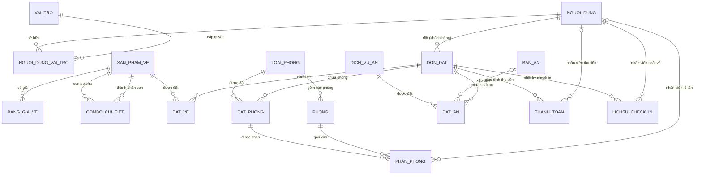

# 🌿 EcoGate (SkyGateHub) — Hệ Thống Quản Trị & Đặt Dịch Vụ Khu Du Lịch Sinh Thái Cổng Trời Đông Giang

<p align="center">
  
  
  
  
  
  
</p>

---

## 📖 Giới Thiệu Tổng Quan (Overview)

**EcoGate (SkyGateHub)** là nền tảng phần mềm web nguyên khối hiện đại (**Modular Monolithic Full-stack**) được xây dựng phục vụ công tác chuyển đổi số toàn diện cho **Khu du lịch sinh thái Cổng Trời Đông Giang** (tỉnh Quảng Nam).

Hệ thống tích hợp trọn vẹn chuỗi cung ứng dịch vụ du lịch khép kín:
1. **Vé tham quan & Cáp treo**: Vé cổng sinh thái, cáp treo, cầu kính và các gói Combo tích hợp.
2. **Khách sạn & Nghỉ dưỡng**: Đặt phòng, kiểm tra phòng trống theo thời gian thực, quản lý phân phòng và sơ đồ phòng vật lý trực quan.
3. **Ẩm thực & Nhà hàng**: Đặt suất ăn Buffet, Set menu đặc sản vùng cao Cơ Tu theo từng ca ăn, quản lý sơ đồ bàn và xếp bàn chống trùng lặp.
4. **Thanh toán & Soát vé**: Giỏ hàng liên dịch vụ, quy trình đặt cọc 30% / thanh toán nốt linh hoạt, cơ chế soát vé & Check-in đa điểm độc lập tại hiện trường.
5. **Báo cáo & Điều hành**: Dashboard phân tích doanh thu, tỷ lệ lấp đầy buồng phòng và công suất phục vụ nhà hàng.

Dự án được thiết kế theo tư duy kiến trúc **Package-by-Feature**, phân tách ranh giới module rõ ràng, phân chia nhiệm vụ cho 5 lập trình viên (M1 – M5) phát triển song song với khả năng xung đột (Git conflict) gần như bằng không.

---

## 📑 Mục Lục (Table of Contents)

- [🌿 Giới Thiệu Tổng Quan](#-giới-thiệu-tổng-quan-overview)
- [✨ Tính Năng Nổi Bật](#-tính-năng-nổi-bật-key-features)
  - [1. Phía Khách Hàng (Customer Portal)](#1-phía-khách-hàng-customer-portal)
  - [2. Phía Quản Trị & Vận Hành (Admin & Staff Portal)](#2-phía-quản-trị--vận-hành-admin--staff-portal)
- [🏛️ Kiến Trúc Hệ Thống (Architecture & Design)](#️-kiến-trúc-hệ-thống-architecture--design)
  - [1. Nguyên Tắc Tổ Chức Package-by-Feature](#1-nguyên-tắc-tổ-chức-package-by-feature)
  - [2. Phân Chia Bounded Context & Chủ Sở Hữu (M1 - M5)](#2-phân-chia-bounded-context--chủ-sở-hữu-m1---m5)
  - [3. Sơ Đồ Thực Thể Nghiệp Vụ (ERD Overview)](#3-sơ-đồ-thực-thể-nghiệp-vụ-erd-overview)
  - [4. Các Quyết Định Nghiệp Vụ Cốt Lõi (Business Rules)](#4-các-quyết-định-nghiệp-vụ-cốt-lõi-business-rules)
- [🛠️ Công Nghệ Sử Dụng (Tech Stack)](#️-công-nghệ-sử-dụng-tech-stack)
- [📂 Cấu Trúc Thư Mục Dự Án (Directory Structure)](#-cấu-trúc-thư-mục-dự-án-directory-structure)
- [🚀 Hướng Dẫn Cài Đặt & Khởi Chạy (Getting Started)](#-hướng-dẫn-cài-đặt--khởi-chạy-getting-started)
  - [1. Yêu cầu môi trường](#1-yêu-cầu-môi-trường)
  - [2. Clone Repository](#2-clone-repository)
  - [3. Khởi tạo Cơ sở dữ liệu (MySQL 8.x)](#3-khởi-tạo-cơ-sở-dữ-liệu-mysql-8x)
  - [4. Cấu hình biến môi trường & application.properties](#4-cấu-hình-biến-môi-trường--applicationproperties)
  - [5. Biên dịch & Chạy ứng dụng](#5-biên-dịch--chạy-ứng-dụng)
- [👥 Tài Khoản Dùng Thử & Phân Quyền (Demo Accounts)](#-tài-khoản-dùng-thử--phân-quyền-demo-accounts)
- [🔄 Quy Trình Phát Triển & Git Workflow (Contribution)](#-quy-trình-phát-triển--git-workflow-contribution)
- [📝 Tài Liệu Liên Quan & Giấy Phép](#-tài-liệu-liên-quan--giấy-phép)

---

## ✨ Tính Năng Nổi Bật (Key Features)

### 1. Phía Khách Hàng (Customer Portal)
- **Tham quan & Báo giá vé động**: Khám phá vé lẻ và combo du lịch; hệ thống tự động nhận diện ngày thường / thứ Bảy & lễ hội để báo giá chuẩn xác theo người lớn và trẻ em.
- **Tìm kiếm & Báo giá phòng nghỉ theo đêm**: Tìm phòng theo khoảng thời gian `[Ngày nhận, Ngày trả)`; hiển thị bảng kê giá chi tiết từng đêm kèm tỷ lệ phụ thu cuối tuần minh bạch.
- **Khám phá ẩm thực & Đặt suất ăn**: Xem thực đơn Buffet, Set cơm trưa/tối đặc sản; lựa chọn ca ăn (`SANG`, `TRUA`, `TOI`) đồng bộ với lịch trình lưu trú.
- **Giỏ hàng hợp nhất (`@SessionScope`)**: Tự do thêm nhiều loại dịch vụ (Vé, Phòng, Suất ăn) vào một giỏ hàng duy nhất trước khi tiến hành thanh toán.
- **Đặt hàng & Thanh toán đa phương thức**: Hỗ trợ cơ chế đặt cọc trước **30%** giá trị đơn hoặc thanh toán toàn bộ; tích hợp cổng thanh toán trực tuyến mô phỏng VNPAY / Chuyển khoản ngân hàng.
- **Quản lý đơn cá nhân**: Tra cứu lịch sử đặt chỗ, trạng thái xử lý, số tiền đã thu / còn nợ và mã QR xác nhận dịch vụ.

### 2. Phía Quản Trị & Vận Hành (Admin & Staff Portal)
- **Quản lý Tài khoản & Phân quyền RBAC**: Quản lý 5 nhóm vai trò người dùng (`QUAN_LY`, `NHAN_VIEN_CHECK_IN`, `NHAN_VIEN_PHAN_PHONG`, `NHAN_VIEN_PHAN_BAN`, `KHACH_HANG`), bảo mật mật khẩu với thuật toán băm BCrypt.
- **Quản trị Vé & Cấu hình Giá**: Tạo vé lẻ, cấu hình gói combo lồng ghép dịch vụ, thiết lập ma trận giá theo từng đối tượng khách và mùa lễ hội.
- **Vận hành Khách sạn & Gán phòng vật lý**:
  - Khóa bi quan (*Pessimistic Locking*) chống xung đột đặt phòng (overbooking) khi khách thanh toán đồng thời.
  - Sơ đồ phòng trực quan (Room Map) hiển thị màu sắc trạng thái từng phòng theo ngày/tầng (Trống, Đã phân, Đang ở, Bảo trì, Đang dọn).
  - Thuật toán gán phòng vật lý cho đơn đặt phòng, loại trừ 100% rủi ro trùng lịch.
- **Quản lý Nhà hàng & Xếp bàn ăn**: Kiểm soát công suất từng bàn theo khu vực/sức chứa; điều phối bàn ăn tự động/thủ công theo ngày và ca ăn.
- **Soát vé & Check-in đa điểm tại hiện trường**:
  - Tra cứu nhanh đơn hàng qua Mã đơn (`MA_DON_CODE`) hoặc Số điện thoại.
  - Thu nốt khoản tiền còn lại (`THANH_TOAN_NOT`) trước khi cho phép nhận dịch vụ.
  - Ghi nhận lịch sử Check-in độc lập theo từng trạm soát: Cổng vé, Cáp treo, Nhận phòng, Bàn ăn.
- **Dashboard Thống kê & Báo cáo Doanh thu**: Biểu đồ doanh thu theo chu kỳ thời gian, thống kê công suất buồng phòng và các chỉ số kinh doanh quan trọng.

---

## 🏛️ Kiến Trúc Hệ Thống (Architecture & Design)

### 1. Nguyên Tắc Tổ Chức Package-by-Feature
Dự án không gom nhóm theo tầng truyền thống (toàn bộ Controller vào 1 chỗ, toàn bộ Service vào 1 chỗ) mà chia theo **Feature Module**. Mỗi module chứa đầy đủ các tầng bên trong:
```
com.example.skygatehub.<feature>
├── entity/          # JPA Entities ánh xạ cơ sở dữ liệu
├── enums/           # Enum trạng thái, phân loại của feature
├── repository/      # Spring Data JPA Repository
├── dto/             # Request DTO (Bean Validation) & Response DTO
├── service/         # Interface dịch vụ (Hợp đồng giao tiếp public)
│   └── impl/        # Service Implementation (@Service, @Transactional)
└── controller/      # Web Controller (Customer / Admin)
```

> [!IMPORTANT]
> **Quy tắc phụ thuộc giữa các Module:**
> - Module khác **chỉ được phép** gọi `Service Interface` và tham chiếu `Entity` (cho quan hệ `@ManyToOne`).
> - **Tuyệt đối cấm** việc tiêm phụ thuộc (Inject) trực tiếp `Repository`, `ServiceImpl` hoặc gọi chéo `Controller` của module khác.

### 2. Phân Chia Bounded Context & Chủ Sở Hữu (M1 - M5)

| Phân hệ (Context) | Package | Các Bảng Dữ Liệu | Thành Viên Phụ Trách |
|---|---|---|:---:|
| **Xác thực, Tài khoản & Vé tham quan** | `auth`, `account`, `ticket` | `NGUOI_DUNG`, `VAI_TRO`, `NGUOI_DUNG_VAI_TRO`, `SAN_PHAM_VE`, `COMBO_CHI_TIET`, `BANG_GIA_VE`, `DAT_VE` | **M1** |
| **Đặt phòng lưu trú (Khách hàng)** | `roombooking` | `DAT_PHONG` | **M2** |
| **Vận hành phòng lưu trú (Quản trị)** | `room` | `LOAI_PHONG`, `PHONG`, `PHAN_PHONG` | **M3** |
| **Ẩm thực & Nhà hàng** | `dining` | `DICH_VU_AN`, `BAN_AN`, `DAT_AN` | **M4** |
| **Đơn tổng, Thanh toán, Check-in, Dashboard** | `cart`, `order`, `payment`, `checkin`, `dashboard` | `DON_DAT`, `THANH_TOAN`, `LICHSU_CHECK_IN` (+ Giỏ hàng Session) | **M5** |
| **Hạ tầng dùng chung** | `common` | Tiện ích (Date, Money, Code), Exception, Security Interceptor, Base Layout | **Chung [C]** |

### 3. Sơ Đồ Thực Thể Nghiệp Vụ (ERD Overview)

Cơ sở dữ liệu gồm **17 bảng quan hệ chuẩn hóa**, trong đó `DON_DAT` là gốc hội tụ liên kết 1-N tới các dịch vụ con (`DAT_VE`, `DAT_PHONG`, `DAT_AN`):



### 4. Các Quyết Định Nghiệp Vụ Cốt Lõi (Business Rules)

- **D1 — Phụ thu buồng phòng**: Áp dụng **+20%** cho các đêm bắt đầu vào **thứ Bảy** và **các đêm ngày Lễ**. Đêm thứ Sáu và Chủ Nhật tính theo giá ngày thường.
- **D2 — Cấu hình ngày Lễ**: Danh sách ngày lễ được quản trị trong cấu hình lặp lại hàng năm (`01-01`, `04-30`, `05-01`, `02-09`) qua `DayTypeResolver`, không hard-code mã nguồn.
- **D3 — Đặt cọc & Điều kiện hủy đơn**:
  - Khách hàng đặt cọc tối thiểu **30%** tổng giá trị đơn để kích hoạt trạng thái `DA_COC`.
  - Khách chỉ được hủy đơn khi **chưa phát sinh bất kỳ lượt Check-in nào**.
- **D4 — Chính sách vé trẻ em**: Trẻ em cao dưới 1,4m được áp dụng chính sách **miễn phí vé (0 VNĐ)**. Khách từ 1,4m trở lên áp dụng vé người lớn.
- **D5 — Ràng buộc bàn ăn**: Mỗi lượt đặt suất ăn (`DAT_AN`) được liên kết với **đúng 1 bàn ăn** phù hợp với sức chứa của bàn.
- **D6 — Soát vé đa điểm độc lập**: Check-in được ghi nhận độc lập theo 4 loại điểm soát: `VE_CONG`, `CAP_TREO`, `NHAN_PHONG`, `AN_UONG`. Hệ thống tự động ngăn chặn check-in trùng lặp cùng điểm soát trong một ngày.

---

## 🛠️ Công Nghệ Sử Dụng (Tech Stack)

| Lĩnh Vực | Công Nghệ / Thư Viện | Phiên Bản | Ghi Chú |
|---|---|---|---|
| **Ngôn ngữ** | Java | OpenJDK 21 | Sử dụng Record, Pattern Matching, Virtual Threads |
| **Framework nền tảng** | Spring Boot | 4.1.1 (hỗ trợ 3.x+) | Web MVC, Data JPA, Validation, DevTools |
| **Giao diện (Frontend)** | Thymeleaf | 3.x | Server-Side Rendering (SSR) với layout fragments |
| **Styling & Hiệu ứng** | Vanilla CSS3, JavaScript | ES6+ | Glassmorphism, Dark/Light palettes, Fetch API |
| **Cơ sở dữ liệu** | MySQL Server | 8.0+ | Engine InnoDB, mã hóa UTF-8 mb4, cột GENERATED |
| **Truy cập dữ liệu** | Hibernate / JPA | 6.x / 7.x | `ddl-auto=validate`, quy ước đặt tên StandardImpl |
| **Bảo mật** | Spring Security Crypto | - | Mã hóa mật khẩu BCrypt, AuthInterceptor + `@RequireRole` |
| **Công cụ hỗ trợ** | Project Lombok | - | Tự động sinh Getter, Setter, Builder |
| **Công cụ đóng gói** | Apache Maven | 3.9+ | Đi kèm sẵn Maven Wrapper (`mvnw`) |

---

## 📂 Cấu Trúc Thư Mục Dự Án (Directory Structure)

```
SkyGateHub/
├── src/
│   ├── main/
│   │   ├── java/com/example/skygatehub/
│   │   │   ├── SkyGateHubApplication.java       # Main entry point Spring Boot
│   │   │   ├── common/                          # [C] Thành phần dùng chung (Chung [C])
│   │   │   │   ├── config/                      # Cấu hình MVC, Properties
│   │   │   │   ├── constant/                    # Hằng số, Session keys
│   │   │   │   ├── enums/                       # RoleName, LoaiKhach, LoaiNgay
│   │   │   │   ├── exception/                   # Mã lỗi & Global Exception Handler
│   │   │   │   ├── security/                    # AuthInterceptor, CurrentUser, PasswordHasher
│   │   │   │   ├── util/                        # DayTypeResolver, DateRangeUtils, MoneyUtils
│   │   │   │   └── web/                         # HomeController, GlobalModelAdvice
│   │   │   ├── auth/                            # [M1] Đăng nhập, đăng ký, phiên làm việc
│   │   │   ├── account/                         # [M1] Quản trị người dùng & phân quyền
│   │   │   ├── ticket/                          # [M1] Sản phẩm vé, combo & bảng giá
│   │   │   ├── roombooking/                     # [M2] Khách hàng tìm kiếm & đặt phòng
│   │   │   ├── room/                            # [M3] Quản lý buồng phòng, sơ đồ & phân phòng
│   │   │   ├── dining/                          # [M4] Thực đơn món ăn, suất ăn & xếp bàn
│   │   │   ├── cart/                            # [M5] Giỏ hàng đa dịch vụ trong Session
│   │   │   ├── order/                           # [M5] Đơn hàng tổng & máy trạng thái đơn
│   │   │   ├── payment/                         # [M5] Giao dịch thanh toán & cổng mô phỏng
│   │   │   ├── checkin/                         # [M5] Tra cứu & soát vé Check-in tại quầy
│   │   │   └── dashboard/                       # [M5] Báo cáo doanh thu & công suất
│   │   └── resources/
│   │       ├── application.properties           # Cấu hình ứng dụng, DataSource, tham số
│   │       ├── application-dev.properties       # Cấu hình môi trường dev (Show SQL, tắt cache)
│   │       ├── messages.properties              # Thông điệp i18n / thông báo lỗi tiếng Việt
│   │       ├── db/mysql/
│   │       │   ├── 01_schema.sql                # Script tạo 17 bảng dữ liệu chuẩn
│   │       │   └── 02_seed_data.sql             # Dữ liệu khởi tạo kiểm thử
│   │       ├── static/                          # CSS, JavaScript, Hình ảnh module
│   │       └── templates/                       # Giao diện Thymeleaf khách hàng & quản trị
│   └── test/java/com/example/skygatehub/        # Bộ kiểm thử Unit Test cho 5 module
├── pom.xml                                      # Quản lý thư viện và plugin Maven
├── mvnw / mvnw.cmd                              # Maven Wrapper cho Linux / Windows
├── scaffold.ps1                                 # Script PowerShell sinh khung xương dự án
├── ARCHITECTURE.md                              # Đặc tả kiến trúc kỹ thuật & thiết kế chi tiết
└── QL_CONG_TROI_DONG_GIANG_MYSQL.sql            # Script CSDL MySQL đầy đủ kèm dữ liệu mẫu
```

---

## 🚀 Hướng Dẫn Cài Đặt & Khởi Chạy (Getting Started)

### 1. Yêu cầu môi trường
Trước khi cài đặt, hãy đảm bảo máy tính đã cài đặt các công cụ sau:
- **Java Development Kit (JDK)**: Phiên bản **21** trở lên ([Tải JDK 21](https://adoptium.net/temurin/releases/?version=21)).
- **MySQL Server**: Phiên bản **8.0** trở lên ([Tải MySQL Community Server](https://dev.mysql.com/downloads/mysql/)).
- **Git**: Công cụ quản lý mã nguồn ([Tải Git](https://git-scm.com/)).
- **IDE**: IntelliJ IDEA (khuyến nghị), Eclipse hoặc VS Code (đã cài Java Extension Pack).

### 2. Clone Repository
Mở Terminal / PowerShell và thực hiện lệnh:
```bash
git clone https://github.com/YuluWusu/SkyGateHub.git
cd SkyGateHub
```

### 3. Khởi tạo Cơ sở dữ liệu (MySQL 8.x)
1. Khởi động dịch vụ MySQL trên máy tính của bạn.
2. Mở MySQL Workbench hoặc chạy lệnh CLI sau để tạo cơ sở dữ liệu `QL_CONG_TROI_DONG_GIANG` và nạp toàn bộ cấu trúc bảng cùng dữ liệu mẫu:
```bash
mysql -u root -p < QL_CONG_TROI_DONG_GIANG_MYSQL.sql
```
*(Nhập mật khẩu MySQL root của bạn khi được yêu cầu)*.

> [!NOTE]
> Database script đã thiết lập sẵn bảng mã `utf8mb4` và collation `utf8mb4_unicode_ci` hỗ trợ đầy đủ tiếng Việt có dấu.

### 4. Cấu hình biến môi trường & application.properties
Mở file `src/main/resources/application.properties`, kiểm tra cấu hình kết nối database:
```properties
spring.datasource.url=jdbc:mysql://localhost:3306/QL_CONG_TROI_DONG_GIANG?useUnicode=true&characterEncoding=UTF-8&serverTimezone=Asia/Ho_Chi_Minh&allowPublicKeyRetrieval=true&useSSL=false
spring.datasource.username=${DB_USERNAME:root}
spring.datasource.password=${DB_PASSWORD:123123}
```

> [!TIP]
> **Khuyến nghị:** Không nên sửa trực tiếp mật khẩu vào file `application.properties` để tránh commit nhầm lên Git. Hãy truyền qua biến môi trường của hệ thống hoặc đặt trong cấu hình Run của IDE:
> - `DB_USERNAME`: Tên người dùng MySQL của bạn (mặc định: `root`)
> - `DB_PASSWORD`: Mật khẩu MySQL của bạn

### 5. Biên dịch & Chạy ứng dụng

#### Trên Windows (PowerShell / CMD):
```powershell
.\mvnw.cmd spring-boot:run
```

#### Trên Linux / macOS:
```bash
chmod +x mvnw
./mvnw spring-boot:run
```

Sau khi ứng dụng khởi động thành công với thông báo:
```
Tomcat started on port 8080 (http) with context path '/'
Started SkyGateHubApplication in ... seconds
```

Mở trình duyệt web và truy cập địa chỉ:
👉 **`http://localhost:8080`**

---

## 👥 Tài Khoản Dùng Thử & Phân Quyền (Demo Accounts)

Hệ thống đã chuẩn bị sẵn các tài khoản mẫu tương ứng với từng vai trò người dùng trong hệ thống (Tất cả tài khoản đều có mật khẩu chung là **`123456`**):

| Tên Đăng Nhập | Mật Khẩu | Vai Trò | Phạm Vi Chức Năng / URL Cho Phép |
|---|:---:|---|---|
| **`admin`** | `123456` | `QUAN_LY` | Toàn quyền quản trị hệ thống: Báo cáo `/admin/dashboard`, Quản lý tài khoản, Quản trị vé, Bảng giá, Loại phòng, Dịch vụ ăn uống, Đơn hàng |
| **`nv_checkin`** | `123456` | `NHAN_VIEN_CHECK_IN` | Quầy soát vé & đón tiếp: Tra cứu đơn, thu tiền nốt `/admin/checkin`, xác nhận check-in các điểm soát |
| **`nv_phong`** | `123456` | `NHAN_VIEN_PHAN_PHONG` | Bộ phận Lễ tân buồng phòng: Xem sơ đồ phòng `/admin/room-map`, tiếp nhận và gán phòng vật lý `/admin/room-assignments` |
| **`nv_ban`** | `123456` | `NHAN_VIEN_PHAN_BAN` | Bộ phận Nhà hàng ẩm thực: Quản lý danh mục bàn `/admin/tables`, điều phối và xếp bàn ăn `/admin/table-assignments` |
| **`khachhang1`** | `123456` | `KHACH_HANG` | Khách du lịch: Xem và đặt vé, tìm đặt phòng, đặt món ăn, quản lý giỏ hàng, thanh toán và xem lịch sử đơn đặt cá nhân |

---

## 🔄 Quy Trình Phát Triển & Git Workflow (Contribution)

Để đảm bảo tiến độ dự án nhóm diễn ra nhịp nhàng và không phát sinh xung đột mã nguồn:

### 1. Phân Nhánh (Branching Strategy)
- **`main`**: Nhánh chính thức, chỉ chứa phiên bản ổn định đã được kiểm thử kỹ lưỡng.
- **`develop`**: Nhánh tích hợp chính hằng ngày của toàn bộ nhóm.
- **`feature/m<X>-<tên-chức-năng>`**: Nhánh làm việc riêng biệt của từng thành viên:
  - `feature/m1-ticket`: Thành viên M1 (Auth & Ticket)
  - `feature/m2-roombooking`: Thành viên M2 (Room Booking khách hàng)
  - `feature/m3-room`: Thành viên M3 (Vận hành phòng quản trị)
  - `feature/m4-dining`: Thành viên M4 (Ẩm thực & Xếp bàn)
  - `feature/m5-order`: Thành viên M5 (Giỏ hàng, Đơn, Thanh toán, Checkin)

### 2. Quy Chuẩn Commit Message
Áp dụng định dạng chuẩn:
```
[M<Số>] <loại>(<phạm vi>): <mô tả ngắn gọn>

Ví dụ:
[M2] feat(roombooking): hoàn thiện tính toán phụ thu phòng đêm thứ Bảy
[M5] fix(payment): bổ sung khóa bi quan chống sai số dư khi thanh toán
[M3] feat(room): dựng sơ đồ phòng theo tầng và ngày lưu trú
```

### 3. Quy Tắc Code Chung
1. **Thực thể JPA (Entity)**:
   - Tên bảng và cột ghi tường minh chữ **IN HOA KHÔNG DẤU** khớp với database.
   - Luôn sử dụng `@Getter @Setter @NoArgsConstructor`. **Tuyệt đối không dùng `@Data`** trên Entity để tránh lỗi lazy loading và đệ quy vô hạn.
   - Tiền tệ bắt buộc dùng `BigDecimal`. Cấm dùng `double` hoặc `float`.
2. **Controller & Giao Diện**:
   - Sử dụng **DTO** cho Request / Response; Controller không nhận hoặc trả trực tiếp Entity ra View.
   - Thao tác ghi dữ liệu bắt buộc nằm trong `@Transactional` tại tầng `ServiceImpl`.

---

## 📝 Tài Liệu Liên Quan & Giấy Phép

- 📘 **Tài liệu Đặc Tả Kiến Trúc Chi Tiết**: Xem file [`ARCHITECTURE.md`](ARCHITECTURE.md) (Quy chuẩn kiến trúc, chi tiết từng bảng, công thức tính giá, file inventory, checklist DOD).
- 🗄️ **Kịch Bản Cơ Sở Dữ Liệu**:
  - MySQL: [`QL_CONG_TROI_DONG_GIANG_MYSQL.sql`](QL_CONG_TROI_DONG_GIANG_MYSQL.sql)
  - SQL Server (Tham chiếu): [`QL_CONG_TROI_DONG_GIANG_SQLSERVER.sql`](QL_CONG_TROI_DONG_GIANG_SQLSERVER.sql)

---

<p align="center">
  Được phát triển với niềm tự hào dành cho <b>Khu Du Lịch Sinh Thái Cổng Trời Đông Giang</b> 🏔️🌲<br>
  <i>Dự án phục vụ học tập, nghiên cứu và phát triển phần mềm doanh nghiệp chất lượng cao.</i>
</p>
