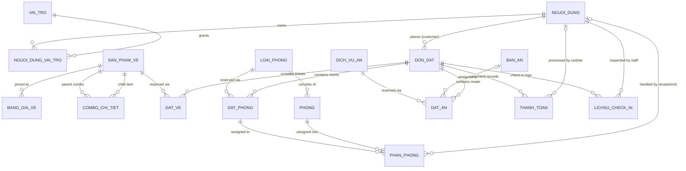

# 🌿 EcoGate (SkyGateHub) — Management & Booking System for Dong Giang Heaven Gate Ecotourism Destination

---

## 📖 Overview

**EcoGate (SkyGateHub)** is a modern **Modular Monolithic Full-stack** web platform engineered to drive comprehensive digital transformation for the **Dong Giang Heaven Gate Ecotourism Destination** (Quang Nam Province, Vietnam).

The system seamlessly consolidates a full-cycle tourism supply chain:

1. **Sightseeing & Cable Car Tickets**: General admission, cable car passes, glass bridge tickets, and bundled combo packages.
2. **Hotel & Hospitality**: Room reservations, real-time availability lookups, physical room allocation, and interactive room status boards.
3. **Dining & Restaurants**: Buffet vouchers, authentic Co Tu ethnic highland set menus organized by meal shifts, floor plan management, and collision-free table assignment.
4. **Checkout & Multi-checkpoint Validation**: Cross-service shopping cart, flexible 30% deposit / balance settlement workflow, and decentralized on-site check-in stations.
5. **Analytics & Operations Dashboard**: High-level reporting on gross revenue, room occupancy rates, and dining capacity utilization.

Architected with a **Package-by-Feature** approach, the system enforces clean module boundaries, enabling a team of 5 developers (M1 – M5) to work concurrently with near-zero Git merge conflicts.

## ✨ Key Features

### 1. Customer Portal

* **Touring & Dynamic Ticket Quotation**: Explore individual tickets and combo packages; automatic detection of regular weekdays vs. Saturdays & public holidays to calculate accurate pricing for adults and children.
* **Nightly Room Search & Quotation**: Query rooms across an open-interval check-in window `[Check-in Date, Check-out Date)`; view an itemized nightly breakdown with transparent weekend surcharge rates.
* **Dining Discovery & Meal Booking**: Browse buffet menus and authentic highland lunch/dinner set menus; choose designated dining shifts (`SANG`, `TRUA`, `TOI`) aligned with itinerary dates.
* **Unified Session Cart (`@SessionScope`)**: Add multiple distinct services (Tickets, Rooms, Meals) into a single cart before final checkout.
* **Flexible Ordering & Multi-tier Payment**: Pay a **30% deposit** upfront or settle in full; includes simulated online payments (VNPAY / direct bank wire).
* **Personal Order Tracking**: Review booking history, processing statuses, paid deposits, outstanding balances, and QR confirmation codes.

### 2. Admin & Staff Operations Portal

* **User Account & RBAC Management**: Enforce 5 role tiers (`QUAN_LY`, `NHAN_VIEN_CHECK_IN`, `NHAN_VIEN_PHAN_PHONG`, `NHAN_VIEN_PHAN_BAN`, `KHACH_HANG`) secured with BCrypt password hashing.
* **Ticket Catalog & Dynamic Pricing**: Create standard tickets, configure composite combos, and manage tiered pricing matrices across customer classes and seasonal events.
* **Hotel Operations & Physical Room Allocation**:
* Pessimistic locking (*Pessimistic Locking*) prevents race conditions and overbooking during concurrent checkouts.
* Interactive room map displays real-time room statuses by date/floor (Available, Assigned, Occupied, Maintenance, Cleaning).
* Allocation engine prevents 100% of double-booking schedule collisions.


* **Restaurant Operations & Table Assignment**: Monitor seating capacity by dining zone; dispatch automated or manual table arrangements by date and meal shift.
* **On-site Multi-checkpoint Ticket Validation**:
* Instant order lookups using Order Code (`MA_DON_CODE`) or phone numbers.
* Settle remaining unpaid balances (`THANH_TOAN_NOT`) directly at reception prior to service usage.
* Record independent check-in timestamps across 4 checkpoints: Entrance Gate, Cable Car, Hotel Check-in, Dining.


* **Analytics & Revenue Dashboard**: Real-time sales metrics, room occupancy rates, and critical business performance KPIs over configurable time horizons.

---

## 🏛️ Architecture & Design

### 1. Package-by-Feature Design Principles

The project abandons traditional horizontal layering (all Controllers in one package, all Services in another) in favor of **Feature Modules**. Each module encapsulates its full vertical slice:

```
com.example.skygatehub.<feature>
├── entity/          # JPA entities mapped to database tables
├── enums/           # Feature-specific status codes and classifications
├── repository/      # Spring Data JPA repositories
├── dto/             # Request DTOs (Bean Validation) & Response DTOs
├── service/         # Service interfaces (Public contract boundaries)
│   └── impl/        # Service implementation (@Service, @Transactional)
└── controller/      # Web Controllers (Customer / Admin)

```

> [!IMPORTANT]
> **Inter-Module Dependency Rules:**
> * Foreign modules **may only** consume `Service Interfaces` or reference `Entity` classes (for `@ManyToOne` associations).
> * **Direct injection** of foreign `Repository`, foreign `ServiceImpl`, or cross-calling foreign `Controller` instances is strictly prohibited.
> 
> 

### 2. Bounded Contexts & Ownership Allocation (M1 - M5)

| Bounded Context | Package | Database Tables | Module Owner |
| --- | --- | --- | --- |
| **Authentication, Accounts & Ticketing** | `auth`, `account`, `ticket` | `NGUOI_DUNG`, `VAI_TRO`, `NGUOI_DUNG_VAI_TRO`, `SAN_PHAM_VE`, `COMBO_CHI_TIET`, `BANG_GIA_VE`, `DAT_VE` | **M1** |
| **Room Reservation (Customer)** | `roombooking` | `DAT_PHONG` | **M2** |
| **Room Operations (Admin)** | `room` | `LOAI_PHONG`, `PHONG`, `PHAN_PHONG` | **M3** |
| **Dining & Restaurant** | `dining` | `DICH_VU_AN`, `BAN_AN`, `DAT_AN` | **M4** |
| **Orders, Payments, Check-in & Dashboard** | `cart`, `order`, `payment`, `checkin`, `dashboard` | `DON_DAT`, `THANH_TOAN`, `LICHSU_CHECK_IN` (+ Session Cart) | **M5** |
| **Shared Infrastructure** | `common` | Utilities (Date, Money, Code), Exception, Security Interceptor, Base Layout | **Shared [C]** |

### 3. Entity-Relationship Overview (ERD)

The relational schema comprises **17 normalized tables**, anchored by `DON_DAT` as the primary root entity maintaining 1-N relationships to child service records (`DAT_VE`, `DAT_PHONG`, `DAT_AN`):



### 4. Core Business Decisions & Rules

* **D1 — Room Surcharges**: A **+20% surcharge** applies to room nights falling on **Saturdays** and **Public Holidays**. Friday and Sunday nights follow standard weekday rates.
* **D2 — Holiday Registry**: Recurring holidays (`01-01`, `04-30`, `05-01`, `02-09`) are externalized via `DayTypeResolver` rather than hardcoded in business logic.
* **D3 — Deposit & Cancellation Policy**:
* Customers must place a minimum deposit of **30%** of total order value to secure the booking in state `DA_COC`.
* Orders can only be cancelled if **zero check-in actions** have taken place.


* **D4 — Child Ticket Policy**: Children under 1.4m receive **free entry (0 VND)**. Visitors 1.4m and taller require adult admission tickets.
* **D5 — Dining Allocation Constraints**: Each dining reservation item (`DAT_AN`) maps to **exactly 1 table** matching seating capacity limits.
* **D6 — Autonomous Multi-checkpoint Validation**: Check-in events are audited independently across 4 station classes: `VE_CONG`, `CAP_TREO`, `NHAN_PHONG`, `AN_UONG`. Duplicate validations at the same station on the same day are automatically blocked.

---

## 🛠️ Tech Stack

| Domain | Technology / Library | Version | Notes |
| --- | --- | --- | --- |
| **Language** | Java | OpenJDK 21 | Records, Pattern Matching, Virtual Threads |
| **Framework** | Spring Boot | 4.1.1 (supports 3.x+) | Web MVC, Data JPA, Validation, DevTools |
| **Presentation (Frontend)** | Thymeleaf | 3.x | Server-Side Rendering (SSR) with layout fragments |
| **Styling & Scripting** | Vanilla CSS3, JavaScript | ES6+ | Glassmorphism UI, Dark/Light modes, Fetch API |
| **Database** | MySQL Server | 8.0+ | InnoDB Engine, UTF-8 mb4 encoding, GENERATED columns |
| **Data Persistence** | Hibernate / JPA | 6.x / 7.x | `ddl-auto=validate`, StandardImpl naming convention |
| **Security** | Spring Security Crypto | - | BCrypt password hashing, AuthInterceptor + `@RequireRole` |
| **Code Generation** | Project Lombok | - | Boilerplate reduction for Getters, Setters, Builders |
| **Build & Dependency Management** | Apache Maven | 3.9+ | Includes bundled Maven Wrapper (`mvnw`) |

---

## 📂 Directory Structure

```
SkyGateHub/
├── src/
│   ├── main/
│   │   ├── java/com/example/skygatehub/
│   │   │   ├── SkyGateHubApplication.java       # Spring Boot main entry point
│   │   │   ├── common/                          # [C] Shared infrastructure components
│   │   │   │   ├── config/                      # Web MVC configurations & application properties
│   │   │   │   ├── constant/                    # Shared constants & session keys
│   │   │   │   ├── enums/                       # Global enums (RoleName, LoaiKhach, LoaiNgay)
│   │   │   │   ├── exception/                   # Global exception handling & error codes
│   │   │   │   ├── security/                    # AuthInterceptor, CurrentUser, PasswordHasher
│   │   │   │   ├── util/                        # DayTypeResolver, DateRangeUtils, MoneyUtils
│   │   │   │   └── web/                         # HomeController, GlobalModelAdvice
│   │   │   ├── auth/                            # [M1] Authentication, registration, session management
│   │   │   ├── account/                         # [M1] User account management & RBAC controls
│   │   │   ├── ticket/                          # [M1] Tickets, combos & pricing catalog
│   │   │   ├── roombooking/                     # [M2] Customer room search & booking flow
│   │   │   ├── room/                            # [M3] Room management, floor maps & allocation
│   │   │   ├── dining/                          # [M4] Dining services, meal booking & table dispatch
│   │   │   ├── cart/                            # [M5] Multi-service session-scoped shopping cart
│   │   │   ├── order/                           # [M5] Composite orders & order state machine
│   │   │   ├── payment/                         # [M5] Payment transactions & mock payment gateway
│   │   │   ├── checkin/                         # [M5] On-site ticket validation & checkpoint check-in
│   │   │   └── dashboard/                       # [M5] Revenue reporting & occupancy metrics
│   │   └── resources/
│   │       ├── application.properties           # Primary application & datasource configurations
│   │       ├── application-dev.properties       # Development profile (SQL logging, cache disabled)
│   │       ├── messages.properties              # i18n localization & validation feedback messages
│   │       ├── db/mysql/
│   │       │   ├── 01_schema.sql                # DDL script creating all 17 normalized tables
│   │       │   └── 02_seed_data.sql             # Pre-seeded test data
│   │       ├── static/                          # Static assets (CSS, JS, images)
│   │       └── templates/                       # Thymeleaf templates for customer & admin portals
│   └── test/java/com/example/skygatehub/        # Unit & integration test suites for modules M1–M5
├── pom.xml                                      # Maven project configuration and dependencies
├── mvnw / mvnw.cmd                              # Maven Wrapper for Linux / Windows
├── scaffold.ps1                                 # PowerShell scaffolding automation script
├── ARCHITECTURE.md                              # Detailed technical architecture specification
└── QL_CONG_TROI_DONG_GIANG_MYSQL.sql            # Complete MySQL dump with schema & seed dataset

```

---

## 🚀 Getting Started

### 1. Prerequisites

Ensure the following tools are installed on your workstation:

* **Java Development Kit (JDK)**: Version **21** or later ([Download JDK 21](https://adoptium.net/temurin/releases/?version=21)).
* **MySQL Server**: Version **8.0** or later ([Download MySQL Community Server](https://dev.mysql.com/downloads/mysql/)).
* **Git**: Source control management ([Download Git](https://git-scm.com/)).
* **IDE**: IntelliJ IDEA (recommended), Eclipse, or VS Code (with Java Extension Pack).

### 2. Clone Repository

Open Terminal or PowerShell and execute:

```bash
git clone https://github.com/YuluWusu/SkyGateHub.git
cd SkyGateHub

```

### 3. Database Initialization (MySQL 8.x)

1. Start your local MySQL service.
2. Open MySQL Workbench or execute the following CLI command to create the database schema `QL_CONG_TROI_DONG_GIANG` and populate seed data:

```bash
mysql -u root -p < QL_CONG_TROI_DONG_GIANG_MYSQL.sql

```

*(Enter your MySQL root password when prompted)*.

> [!NOTE]
> The database script initializes with `utf8mb4` character encoding and `utf8mb4_unicode_ci` collation, ensuring complete support for accented characters and special symbols.

### 4. Configure Environment & application.properties

Inspect `src/main/resources/application.properties` to ensure database connection parameters align with your environment:

```properties
spring.datasource.url=jdbc:mysql://localhost:3306/QL_CONG_TROI_DONG_GIANG?useUnicode=true&characterEncoding=UTF-8&serverTimezone=Asia/Ho_Chi_Minh&allowPublicKeyRetrieval=true&useSSL=false
spring.datasource.username=${DB_USERNAME:root}
spring.datasource.password=${DB_PASSWORD:123123}

```

> [!TIP]
> **Recommendation:** Avoid committing plain-text database credentials to source control. Supply these values via system environment variables or through IDE Run/Debug configurations:
> * `DB_USERNAME`: Your MySQL username (defaults to `root`)
> * `DB_PASSWORD`: Your MySQL root password
> 
> 

### 5. Build & Run Application

#### On Windows (PowerShell / CMD):

```powershell
.\mvnw.cmd spring-boot:run

```

#### On Linux / macOS:

```bash
chmod +x mvnw
./mvnw spring-boot:run

```

Once the application finishes booting, verify the console log:

```
Tomcat started on port 8080 (http) with context path '/'
Started SkyGateHubApplication in ... seconds

```

Launch your web browser and navigate to:
👉 **`http://localhost:8080`**

---

## 👥 Demo Accounts & Access Control

Pre-seeded demo accounts are available for testing each role boundary (All accounts share the default password **`123456`**):

| Username | Password | Role | Permitted Scope & Entry Points |
| --- | --- | --- | --- |
| **`admin`** | `123456` | `QUAN_LY` | Full system governance: Executive dashboard `/admin/dashboard`, account management, tickets, pricing matrices, room categories, dining catalogs, composite orders |
| **`nv_checkin`** | `123456` | `NHAN_VIEN_CHECK_IN` | Check-in counter operations: Order search, remaining balance settlement `/admin/checkin`, ticket validation across physical checkpoints |
| **`nv_phong`** | `123456` | `NHAN_VIEN_PHAN_PHONG` | Front desk & housekeeping: Visual room board `/admin/room-map`, reservation queue & physical room dispatch `/admin/room-assignments` |
| **`nv_ban`** | `123456` | `NHAN_VIEN_PHAN_BAN` | Dining room management: Dining table catalog `/admin/tables`, shift-based seating coordination `/admin/table-assignments` |
| **`khachhang1`** | `123456` | `KHACH_HANG` | End customer: Browse & book tickets, reserve rooms, order dining plans, manage cart, complete payments, view booking confirmations |

---

## 🔄 Development & Git Workflow

Follow these collaborative Git conventions to ensure smooth integration:

### 1. Branching Strategy

* **`main`**: Production-ready branch containing thoroughly validated code.
* **`develop`**: Primary staging and daily integration branch.
* **`feature/m<X>-<feature-name>`**: Dedicated feature branches per team member:
* `feature/m1-ticket`: Member M1 (Auth & Tickets)
* `feature/m2-roombooking`: Member M2 (Customer Room Booking)
* `feature/m3-room`: Member M3 (Admin Room Operations)
* `feature/m4-dining`: Member M4 (Dining & Table Dispatch)
* `feature/m5-order`: Member M5 (Cart, Orders, Payment, Check-in)


### 2. Commit Message Conventions

Adopt standard conventional commit formats:

```
[M<Number>] <type>(<scope>): <short description>

Examples:
[M2] feat(roombooking): implement Saturday night room surcharge calculation
[M5] fix(payment): add pessimistic locking to prevent balance concurrency anomalies
[M3] feat(room): render floor-based room status board by stay date

```

### 3. Engineering Guidelines

1. **JPA Entities**:
* Table and column annotations must explicitly use **UPPERCASE** characters matching the SQL schema.
* Always annotate with `@Getter @Setter @NoArgsConstructor`. **Never use `@Data**` on JPA Entities to prevent infinite recursion and lazy-loading hazards.
* All financial amounts must strictly use `BigDecimal`. Never use `double` or `float`.


2. **Controllers & Views**:
* Encapsulate data exchange via **DTOs** for Request / Response mappings; Controllers must not pass Entity instances directly into Views.
* Any database mutation must execute inside an active `@Transactional` boundary in the `ServiceImpl` layer.


---

## 📝 References & License

* 📘 **Technical Architecture Specification**: Refer to [`ARCHITECTURE.md`](https://www.google.com/search?q=ARCHITECTURE.md) (Architectural standards, schema specifications, pricing models, file inventory, DOD checklists).
* 🗄️ **Database Initialization Scripts**:
* MySQL: [`QL_CONG_TROI_DONG_GIANG_MYSQL.sql`](https://www.google.com/search?q=QL_CONG_TROI_DONG_GIANG_MYSQL.sql)
* SQL Server (Reference): [`QL_CONG_TROI_DONG_GIANG_SQLSERVER.sql`](https://www.google.com/search?q=QL_CONG_TROI_DONG_GIANG_SQLSERVER.sql)


---
