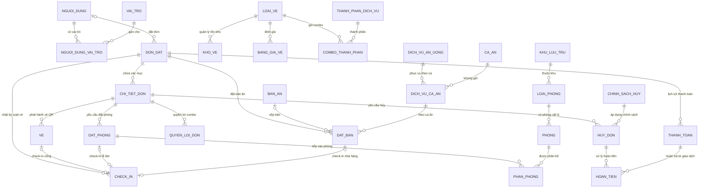

# 🌿 SkyGateHub — Hệ Thống Quản Lý & Đặt Dịch Vụ Khu Du Lịch Sinh Thái Cổng Trời Đông Giang

---

## 📖 1. Tổng Quan Dự Án (Overview)

**SkyGateHub (EcoGate)** là nền tảng Web Full-stack xây dựng bằng **Java Spring Boot**, phục vụ chuyển đổi số toàn diện cho **Khu Du Lịch Sinh Thái Cổng Trời Đông Giang**. Hệ thống tích hợp trọn vẹn chuỗi cung ứng dịch vụ du lịch trên một luồng đặt chỗ hợp nhất (Unified Booking Pipeline) và hệ thống soát vé đa trạm qua mạng **TCP Socket**:

1. **Vé Tham Quan & Cáp Treo (`ticket`)**: Quản lý danh mục vé lẻ, gói Combo đa dịch vụ, tồn kho vé theo ngày (`KHO_VE`), bảng giá linh hoạt theo mùa/ngày lễ (`BANG_GIA_VE`, `NGAY_DAC_BIET`).
2. **Khách Sạn & Lưu Trú (`room`, `roombooking`)**: Quản lý 4 khu lưu trú (`FIVITEL Sông Ngân`, `FIVITEL Cầu Kiều`, `FIVITEL Ô Thước`, `Nhà Moong`), 15 hạng phòng thực tế và 30 phòng vật lý; tự động tính phụ thu đêm Thứ Bảy/Ngày lễ (+20%); sơ đồ phòng trực quan (Room Map) và phân phòng chống trùng lịch bằng khóa bi quan (*Pessimistic Locking*).
3. **Ẩm Thực & Nhà Hàng (`dining`)**: Quản lý thực đơn Buffet, Set Menu vùng cao Cơ Tu theo 3 ca ăn (`CA_SANG`, `CA_TRUA`, `CA_TOI`), sơ đồ bàn ăn theo khu vực và điều phối xếp bàn tự động/thủ công.
4. **Đặt Dịch Vụ, Thanh Toán & Hoàn Hủy (`order`, `payment`, `cancellation`)**: Quy trình đặt dịch vụ 4 bước (Vé $\rightarrow$ Phòng $\rightarrow$ Ẩm thực $\rightarrow$ Đặt cọc 30%), sinh mã định danh duy nhất đa luồng (`OrderCodeGenerator`), quản lý chính sách cọc, hủy đơn và hoàn tiền.
5. **Soát Vé Đa Trạm & Xử Lý Đồng Thời (`checkin`, `common.concurrent`, `common.network`)**:
   - **Đa luồng & Tác vụ nền**: Tác vụ bất đồng bộ `@Async` (`AsyncTaskService`) sinh mã QR và gửi thông báo/email xác nhận; tác vụ định kỳ `@Scheduled` (`ScheduledTaskService`) tự động rà soát và hủy đơn chờ quá hạn giữ chỗ 30 phút.
   - **Lập trình mạng TCP Socket**: `CheckInSocketServer` (cổng TCP `9090`, dùng `ExecutorService` ThreadPool 10 luồng) phục vụ đồng thời nhiều chương trình `GateCheckinClientApp` (Java Swing Desktop Client tách biệt) tại các trạm Cổng vào, Lễ tân và Nhà hàng.
6. **Thống Kê & Báo Cáo Doanh Thu (`dashboard`)**: Tổng hợp doanh thu thực thu, tiền cọc, hoàn tiền, tỷ lệ lấp đầy phòng và lưu lượng khách check-in theo thời gian thực.

---

## 🛠️ 2. Công Nghệ Sử Dụng (Tech Stack)

| Tầng / Thành phần | Công nghệ / Thư viện | Phiên bản | Ghi chú |
| :--- | :--- | :--- | :--- |
| **Ngôn ngữ lập trình** | Java (OpenJDK) | **JDK 21** | Hỗ trợ Multi-threading, Socket API, Stream, Record |
| **Web Framework** | Spring Boot | **4.1.1** (tương thích 3.x+) | Spring Web MVC, Validation (`@Valid`), `@Async`, `@Scheduled` |
| **Truy cập CSDL** | Spring Data JPA / Hibernate | 6.x / 7.x | `@Transactional`, `@Lock(PESSIMISTIC_WRITE)`, 50+ `@Query` |
| **Cơ sở dữ liệu** | MySQL Server | **8.0+** | InnoDB Engine, UTF-8 (`utf8mb4`), 29 bảng + 1 View tổng hợp |
| **Giao diện Web** | Thymeleaf + Bootstrap 5 | 3.x / 5.3.3 | Layout Fragment dùng chung, Responsive Mobile/Desktop |
| **Ứng dụng Client mạng** | Java Swing + TCP Socket | JDK 21 | `GateCheckinClientApp` kết nối trực tiếp tới `CheckInSocketServer` |
| **Bảo mật & Phân quyền** | Spring Security Crypto | BCrypt | Băm mật khẩu BCrypt, `AuthInterceptor` + `@RequireRole` |
| **Kiểm thử** | JUnit 5 + Mockito | 5.x | Kiểm thử đơn vị, kiểm thử đa luồng (`CountDownLatch`) & Socket |
| **Quản lý gói & Build** | Apache Maven | 3.9+ | Tích hợp sẵn Maven Wrapper (`mvnw`, `mvnw.cmd`) |

---

## 🏛️ 3. Kiến Trúc Hệ Thống & Cơ Sở Dữ Liệu

### 3.1. Kiến trúc phân tầng (Controller – Service – Repository – Entity – View)

Dự án tuân thủ nghiêm ngặt kiến trúc phân tầng chuẩn của Spring Boot kết hợp chia theo phân hệ nghiệp vụ:

```text
SkyGateHub/
├── src/main/java/com/example/skygatehub/
│   ├── SkyGateHubApplication.java          # Điểm khởi chạy ứng dụng Spring Boot
│   ├── common/                             # Hạ tầng dùng chung toàn hệ thống
│   │   ├── concurrent/                     # Đa luồng: AsyncConfig, AsyncTaskService (@Async),
│   │   │                                   #           SchedulerConfig, ScheduledTaskService (@Scheduled)
│   │   ├── network/                        # Lập trình mạng TCP Socket (Tiêu chí 5.3, 5.4)
│   │   │   ├── server/                     # CheckInSocketServer (Port 9090), CheckInClientHandler
│   │   │   └── client/                     # GateCheckinClientApp (Ứng dụng Swing Client độc lập)
│   │   ├── config/                         # WebMvcConfig (đăng ký Interceptor, ViewController)
│   │   ├── constant/                       # SessionKeys
│   │   ├── enums/                          # Tập hợp 28 Enum trạng thái dùng chung toàn dự án
│   │   ├── exception/                      # GlobalExceptionHandler (@ControllerAdvice), BusinessException
│   │   ├── security/                       # AuthInterceptor, @RequireRole, CurrentUser, PasswordHasher
│   │   ├── util/                           # OrderCodeGenerator (Atomic), DayTypeResolver, DateRangeUtils, MoneyUtils
│   │   └── web/                            # HomeController, PageController, GlobalModelAdvice
│   ├── controller/                         # Tầng Controller (Tiếp nhận HTTP Request, @Valid, trả về View)
│   │   ├── account/, auth/, checkin/, dashboard/, dining/, order/, payment/, room/, roombooking/, ticket/
│   ├── service/                            # Tầng Service (Giao diện & Thực thi nghiệp vụ @Transactional)
│   │   ├── account/, auth/, checkin/, dining/, order/, payment/, room/, ticket/
│   ├── repository/                         # Tầng Repository (Kế thừa JpaRepository, @Query, @Lock)
│   │   ├── account/, cancellation/, checkin/, dining/, order/, payment/, room/, roombooking/, ticket/
│   ├── entity/                             # Tầng Entity JPA (Ánh xạ 29 bảng & 1 View trong CSDL)
│   │   ├── account/, cancellation/, checkin/, dining/, order/, payment/, room/, roombooking/, ticket/
│   └── dto/                                # Tầng DTO (Request/Response, Bean Validation)
├── src/main/resources/
│   ├── application.properties              # Cấu hình cổng, kết nối CSDL MySQL, quy tắc nghiệp vụ
│   ├── messages.properties                 # Thông điệp đa ngôn ngữ & kiểm tra hợp lệ
│   ├── db/                                 # Script SQL khởi tạo bảng (01_schema.sql) và dữ liệu mẫu (02_seed_data.sql)
│   ├── static/                             # Tài nguyên tĩnh (CSS, JS, Hình ảnh khu du lịch)
│   └── templates/                          # 50+ giao diện Thymeleaf (fragments, layout, admin, customer)
├── src/test/java/com/example/skygatehub/   # Bộ kiểm thử JUnit 5 (Đa luồng, Socket, Nghiệp vụ)
│   ├── concurrent/ConcurrencyAndSocketTest.java
│   ├── common/util/DayTypeResolverTest.java
│   └── service/...
└── QL_CONG_TROI_DONG_GIANG_MYSQL.sql       # File SQL tổng hợp (Schema + Seed Data >= 20 bản ghi/bảng chính)
```

### 3.2. Sơ đồ Quan hệ Thực thể (ERD — 29 Bảng chuẩn hóa)

Cơ sở dữ liệu `QL_CONG_TROI_DONG_GIANG` gồm **29 bảng dữ liệu** và **1 View tổng hợp (`V_DON_DAT_TONG_HOP`)**, lấy `DON_DAT` và `CHI_TIET_DON` làm trung tâm kết nối các phân hệ:



### 3.3. Thiết kế Xử lý Đồng thời & Giao thức Mạng Socket (Tiêu chí 1.5 & 5)

1. **Tài nguyên dùng chung & Đồng bộ hóa (Tiêu chí 5.1, 5.2)**:
   - **Tác vụ nền (`@Async`)**: `AsyncTaskService` chạy trên `ThreadPoolTaskExecutor` (`AsyncWorker-*`) để sinh mã QR Token và gửi email/thông báo xác nhận sau khi đặt đơn hoặc duyệt thanh toán mà không làm chậm phản hồi HTTP của khách hàng.
   - **Tác vụ định kỳ (`@Scheduled`)**: `ScheduledTaskService` chạy mỗi 60 giây trên luồng `Scheduler-*` để tự động hủy các đơn ở trạng thái `CHO_XAC_NHAN` quá 30 phút chưa thanh toán cọc.
   - **Chống Race Condition / Quét trùng vé / Overbooking**: Sử dụng khóa bi quan `@Lock(LockModeType.PESSIMISTIC_WRITE)` trên `VeRepository`, `KhoVeRepository`, `PhongRepository`, `PhanPhongRepository` kết hợp khóa đồng bộ theo mã tài nguyên (`synchronized` + `ConcurrentHashMap`) và `AtomicInteger` trong `OrderCodeGenerator`.

2. **Giao thức Mạng TCP Socket (`CheckInSocketServer` $\leftrightarrow$ `GateCheckinClientApp`) (Tiêu chí 5.3, 5.4)**:
   - **Cổng lắng nghe**: TCP Port `9090` (cấu hình qua `socket.server.port`), sử dụng `Executors.newFixedThreadPool(10)` (`SocketWorker-1` $\rightarrow$ `SocketWorker-10`), phục vụ đồng thời tối thiểu 3–10 Client cùng lúc.
   - **Định dạng bản tin (RFC Text Protocol qua UTF-8)**:

| Lệnh từ Client | Cú pháp gửi | Phản hồi từ Server | Ý nghĩa nghiệp vụ |
| :--- | :--- | :--- | :--- |
| **`PING`** | `PING` | `200 PONG ServerThread=SocketWorker-X ...` | Kiểm tra kết nối và luồng phục vụ |
| **`AUTH`** | `AUTH\|<TEN_TRAM>` | `200 AUTH_OK Trạm [...] đã xác thực...` | Định danh trạm soát vé / lễ tân / nhà hàng |
| **`LOOKUP`** | `LOOKUP\|<MA_VE_HOAC_MA_DON>` | `200 OK_VE ...` / `200 OK_DON ...` / `404` | Tra cứu thông tin vé, đơn hàng, phòng, bàn |
| **`CHECKIN_VE`** | `CHECKIN_VE\|<MA_VE>` | `200 CHECKIN_SUCCESS ...` / `409 CONFLICT` | Soát vé qua cổng (khóa bi quan chống quét trùng) |
| **`CHECKIN_PHONG`**| `CHECKIN_PHONG\|<MA_DP>\|<NV>`| `200 CHECKIN_PHONG_OK ...` / `409 CONFLICT`| Check-in nhận phòng tại quầy Lễ tân |
| **`CHECKIN_AN`** | `CHECKIN_AN\|<MA_DAT_BAN>` | `200 CHECKIN_SUCCESS ...` / `409 CONFLICT` | Check-in bàn ăn tại Nhà hàng |
| **`STATS`** | `STATS` | `200 STATS TongLuotCheckIn=...` | Thống kê tổng lượt check-in toàn hệ thống |
| **`QUIT`** | `QUIT` | `200 BYE Goodbye!` | Đóng phiên kết nối và giải phóng tài nguyên |

---

## 🚀 4. Hướng Dẫn Cài Đặt & Chạy Chương Trình

### Bước 1: Yêu cầu môi trường (Prerequisites)
* **JDK**: Phiên bản **Java 21** trở lên (`java -version`).
* **MySQL Server**: Phiên bản **8.0** trở lên.
* **Maven**: Đã tích hợp sẵn `./mvnw` (Linux/macOS) và `.\mvnw.cmd` (Windows) trong thư mục dự án.

### Bước 2: Khởi tạo Cơ sở dữ liệu (MySQL)
Mở **MySQL Workbench** hoặc **Terminal / Command Prompt**, chạy file script tổng hợp `QL_CONG_TROI_DONG_GIANG_MYSQL.sql` nằm ở thư mục gốc của dự án (file này tự động tạo database `QL_CONG_TROI_DONG_GIANG`, tạo 29 bảng + 1 View và nạp sẵn $\ge 20$ bản ghi mẫu cho từng bảng nghiệp vụ chính):

```bash
mysql -u root -p < QL_CONG_TROI_DONG_GIANG_MYSQL.sql
```
*(Hoặc chạy lần lượt `src/main/resources/db/01_schema.sql` rồi đến `src/main/resources/db/02_seed_data.sql` trong MySQL Workbench).*

### Bước 3: Cấu hình kết nối trong `application.properties`
Kiểm tra file `src/main/resources/application.properties`:

```properties
spring.datasource.url=jdbc:mysql://localhost:3306/QL_CONG_TROI_DONG_GIANG?useUnicode=true&characterEncoding=UTF-8&serverTimezone=Asia/Ho_Chi_Minh&allowPublicKeyRetrieval=true&useSSL=false
spring.datasource.username=${DB_USERNAME:root}
spring.datasource.password=${DB_PASSWORD:123123}
```
*(Thay `123123` bằng mật khẩu `root` MySQL trên máy của bạn hoặc truyền qua biến môi trường `DB_PASSWORD`).*

### Bước 4: Chạy Ứng dụng Web Server & Socket Server
Tại thư mục gốc của dự án, mở PowerShell / Terminal và chạy:

```powershell
.\mvnw.cmd spring-boot:run
```
Khi khởi động thành công:
* **Web Server (Spring Boot MVC)** lắng nghe tại: 👉 **`http://localhost:8080`**
* **Socket Server (`CheckInSocketServer`)** tự động chạy ngầm tại cổng TCP: 👉 **`localhost:9090`**

### Bước 5: Chạy Chương trình Socket Client tách biệt (`GateCheckinClientApp`)
Để demo **Tiêu chí 5.3 & 5.4 (Mở đồng thời từ 3 cửa sổ Client trở lên kết nối vào Server)**:

* **Cách 1 (Trong IntelliJ IDEA / Eclipse / VS Code):**
  Mở file [`src/main/java/com/example/skygatehub/common/network/client/GateCheckinClientApp.java`](src/main/java/com/example/skygatehub/common/network/client/GateCheckinClientApp.java) và nhấn **Run `GateCheckinClientApp.main()`** (có thể bấm Run 3 lần để mở 3 cửa sổ trạm soát vé độc lập cùng lúc).
* **Cách 2 (Bằng dòng lệnh Terminal / PowerShell):**
  Mở 3 cửa sổ PowerShell mới và chạy lệnh:
  ```powershell
  .\mvnw.cmd exec:java -Dexec.mainClass="com.example.skygatehub.common.network.client.GateCheckinClientApp"
  ```

### Bước 6: Chạy Kiểm thử Đa luồng & Kiểm thử 5 Socket Client đồng thời
Để chạy chương trình kiểm thử tự động chứng minh **Tiêu chí 5.2, 5.3, 5.4** (10 luồng quét cùng 1 mã vé + 5 Socket Client kết nối đồng thời):

```powershell
.\mvnw.cmd test -Dtest=ConcurrencyAndSocketTest
```

---

## 👥 5. Tài Khoản Demo Phân Quyền (Mật khẩu chung: `123456`)

| Tên đăng nhập | Mật khẩu | Vai trò (`VAI_TRO`) | Phân hệ được phép truy cập |
| :--- | :--- | :--- | :--- |
| **`admin`** | `123456` | `QUAN_LY` (`VT001`) | Toàn quyền quản trị: Dashboard `/admin/dashboard`, doanh thu, tài khoản, loại vé, bảng giá, phòng, bàn ăn, đơn đặt, thanh toán |
| **`nv_ve1`** / **`nv_ve2`** | `123456` | `NHAN_VIEN_VE` (`VT004`) | Quầy vé & Soát vé cổng: `/admin/checkin`, quản lý vé, bảng giá, thanh toán |
| **`nv_letan1`** | `123456` | `NHAN_VIEN_LUU_TRU` (`VT006`) | Lễ tân khách sạn: Sơ đồ phòng `/admin/room-map`, danh sách phòng & phân phòng |
| **`nv_bep1`** / **`nv_nhahang1`** | `123456` | `NHAN_VIEN_NHA_HANG` (`VT005`) | Điều phối nhà hàng: Quản lý bàn ăn `/admin/tables`, xếp bàn theo ca `/admin/table-assignments` |
| **`khach08`** $\rightarrow$ **`khach25`** | `123456` | Khách hàng | Đặt dịch vụ `/dat-dich-vu`, tra cứu đơn `/tra-cuu-don`, xem vé/phòng/ẩm thực, hồ sơ cá nhân |

---

## 📚 6. Tài Liệu Tham Khảo Dự Án

* **Đặc tả kiến trúc chi tiết**: [`ARCHITECTURE.md`](ARCHITECTURE.md)
* **Script CSDL tổng hợp (MySQL 8.0+)**: [`QL_CONG_TROI_DONG_GIANG_MYSQL.sql`](QL_CONG_TROI_DONG_GIANG_MYSQL.sql)
* **Script DDL & Seed Data**: [`src/main/resources/db/01_schema.sql`](src/main/resources/db/01_schema.sql) và [`src/main/resources/db/02_seed_data.sql`](src/main/resources/db/02_seed_data.sql)
